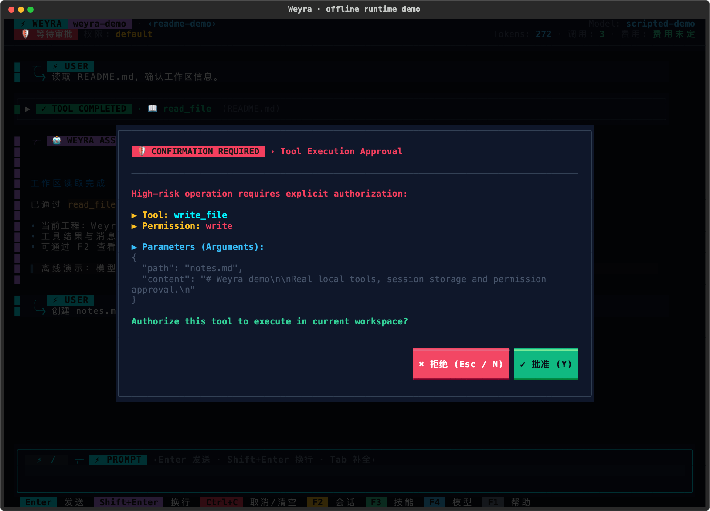
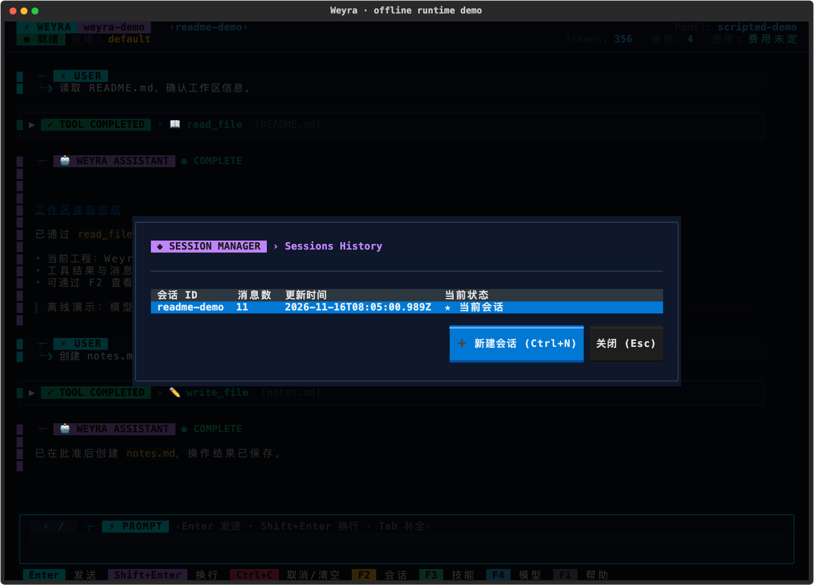

<div align="center">

# Weyra

### 面向持续任务与技能演进的轻量 Python Agent Harness

[](https://www.python.org/)
[](LICENSE)
[](https://github.com/WenYuecheng/Weyra/actions/workflows/ci.yml)
[](#实际运行截图)

**可追溯执行 · 长上下文管理 · 请求前预算治理 · 验证驱动技能更新**

</div>

Weyra 将模型推理、工具执行、会话状态和技能演进组织成可持续运行的 Python Agent 系统。终端界面提供对话、工具卡片、权限审批和会话管理；后端负责执行循环、模型协议适配、上下文压缩、预算记账和持久化。

界面层由 **流式 CLI 和 Textual TUI** 构成，通过 `WeyraAppService` 与后端交互。所有界面、应用服务和运行时源码均包含在本仓库中，可在本地安装运行。

## 实际运行截图

以下图片来自本仓库 Textual 应用的实际运行，通过临时工作区完成文件读取、写入审批与会话持久化后导出。演示使用预设模型响应，无需 API 密钥；工具操作、服务事件和界面交互由真实应用执行。

### 主界面

支持多行输入、斜杠命令推荐、状态栏及快捷键导航。


### 文件读取与工具结果

在输入区提交任务后，后端读取演示工作区的 `README.md`，界面展示工具执行结果和 Markdown 回复。


### 写入审批

默认权限模式下，创建 `notes.md` 前弹出审批窗口，展示工具名称和参数；批准后才实际写入文件。



### 会话管理

按 `F2` 或 `Ctrl+P` 打开会话列表，查看消息数、当前会话及更新时间，也可新建会话。



<details>
<summary>查看快捷键与命令帮助截图</summary>


</details>

## 核心能力

- **执行循环**：模型调用、工具执行、有限重试、取消传播，以及 steering / follow-up 双队列。
- **工具治理**：JSON Schema 参数校验、项目路径检查、读写协调、审批后策略重检，以及可选的多文件 patch。
- **长上下文管理**：结构化检查点压缩、Usage Anchor 动态校准、工具大结果中间剪枝和全文产物外置。
- **会话与任务恢复**：SQLite WAL、追加式事件日志、会话树与独立领域投影，支持恢复、分支和派生。
- **预算管理**：模型请求前预留 Token、调用次数及费用，按返回 Usage 结算，父子任务共享预算约束。
- **技能演进与过程审计**：激活条件优先的技能检索、`[ANCHOR]` 受保护规则护栏、分类知识配额隔离、有界补丁与被拒编辑缓冲、无基线对照新建门禁、确定性断言短路验证，以及 SQLite 只读过程质量与技能漏斗审计。自动演进默认关闭，开启需显式配置验证集与路由；架构详见 [docs/skill-evolution.md](docs/skill-evolution.md)。
- **模型接入**：OpenAI-compatible 与 Anthropic-compatible 协议，按主任务、压缩、记忆和演进等用途配置路由。
- **应用接口**：`WeyraAppService` 提供提交、取消、状态快照、历史查询和事件订阅，可嵌入自己的 Python 应用。

## 快速上手

需要 Python 3.11+，推荐 macOS / Linux。

```bash
git clone https://github.com/WenYuecheng/Weyra.git
cd Weyra
python3 -m venv .venv
source .venv/bin/activate
python -m pip install -e '.[tui]'
```

### 无密钥体验

```bash
# 流式 CLI：执行真实文件读取并输出结果
weyra --demo --project /tmp/weyra-cli-demo

# 全屏 TUI：在终端中启动后输入任务
weyra --demo --ui tui --project /tmp/weyra-tui-demo

# 多步骤离线场景
weyra demo --scenario analysis --offline --project /tmp/weyra-analysis
weyra demo --scenario writing --offline --project /tmp/weyra-writing

# Python 应用服务示例
python -m examples.sdk_service
```

TUI 离线模式启动后，可输入“读取 `.weyra/demo-fixture.txt` 并报告结果”体验一次完整工具调用。离线响应是固定脚本；持续自由对话需要配置真实模型。

### 接入真实模型

```bash
cp weyra.example.toml weyra.toml
cp .env.example .env
# 在 .env 中填写密钥，在 weyra.toml 中配置端点和模型容量
weyra check-config --project .

# 启动交互界面，或直接执行一次任务
weyra --project . --ui tui
weyra "阅读项目并总结核心执行链路" --project .
```

配置模板默认使用 DeepSeek 的 OpenAI 兼容协议。接入其他端点时，修改 `providers` 的 `protocol`、`base_url`、`api_key_env`，以及 `routes.main` 的模型、上下文容量和输出上限。密钥存放在 `.env`，个人路由存放在 `weyra.toml`，两者均被忽略。模板详见 [weyra.example.toml](weyra.example.toml) 和 [.env.example](.env.example)。

### 常用操作

| 操作 | 入口 |
| --- | --- |
| 发送 / 换行 | `Enter` / `Shift+Enter` |
| 查看帮助 | `F1` 或 `/help` |
| 管理会话 | `F2`、`Ctrl+P` 或 `/sessions` |
| 查看技能 | `F3`、`Ctrl+K` 或 `/skills` |
| 查看模型路由 | `F4` 或 `/models` |
| 用量与费用 | `/usage`、`/cost` |
| 计划权限模式 | `/plan on`、`/plan off` |
| 压缩 / 清空活动上下文 | `/compact` / `/clear` |
| 分支 / 派生 | `/branch`、`/fork` |
| 目标恢复 / 重新开始 | `/goal resume` / `/goal restart` |
| 取消任务 / 清空草稿 / 退出 | `Ctrl+C`，根据当前状态执行 |

默认权限模式会对需要授权的操作发起审批。会话数据库、记忆、技能版本及工具产物在目标工程的 `.weyra/` 下生成。

## 评测概览

### Aider Polyglot 后端与系统语言基准

基于 **Aider Polyglot** 在 **Python、Go、Rust、C++、Java** 五种后端与系统语言上的 168 组同题配对对照（共享模型、工具与有界测试反馈，最多两轮提交，Docker 隔离验收）：

- **两轮累计通过率达 72.62%（122/168）**，较最小工具循环基线 **65.48%（110/168）** **相对提升 +10.91%**（净胜 +12 题），五门语言零退步。
- **首轮失败自修复率达 60.98%（75/123）**，较基线 **50.41%（61/121）** **相对提升 +20.95%**；其中 **C++ 修复率 81.0%**（最终通过率 **84.6%**）、**Python 修复率 70.8%**（最终通过率 **78.8%**）、**Go 修复率 61.5%**。
- **Token 实耗较基线节省 13.66%**。

| 语言 | 有效配对 | Weyra 修复率 | 基线修复率 | 修复相对提升 | 两轮累计 Weyra / 基线 | 通过率相对提升 |
| --- | ---: | ---: | ---: | ---: | ---: | ---: |
| Python | 33 | 70.8% | 58.3% | **+21.4%** | **26 / 23** | **+13.0%** |
| Go | 37 | 61.5% | 43.5% | **+41.5%** | **27 / 24** | **+12.5%** |
| Rust | 28 | 50.0% | 44.4% | **+12.5%** | **19 / 19** | **0.0%** |
| C++ | 26 | 81.0% | 61.1% | **+32.5%** | **22 / 19** | **+15.8%** |
| Java | 44 | 46.9% | 47.4% | -1.0% | **28 / 25** | **+12.0%** |
| **五种语言合计** | **168** | **60.98%** | **50.41%** | **+20.95%** | **122 / 110** | **+10.91%** |

### 技能演进护栏与系统可靠性验证

- **离线零 API 可靠性与长程抗退化**：6 类故障注入回归全部通过；30 轮连续演进压测下，受保护 `[ANCHOR]` 规则与核心 `boundary` 知识留存率均由无护栏基线的 **0% 提升至 100%**，确定性验证短路实现零裁判模型调用；只读轨迹审计可准确区分高合规 `ideal` 与 `lucky_pass` 轨迹。
- **多域技能盲选路由与在线演进**：在三类企业运维/交付合规域、无技能名提示且并存干扰技能的条件下，目标技能精准激活率 **100%（18/18）**、干扰误触发 **0%**、任务全部以 `ideal` 轨迹通过，并验证受保护规则拦截、有界补丁晋升与无基线对照新建门禁。

评测说明与复现命令见 [benchmarks/README.md](benchmarks/README.md)，设计原理见 [docs/skill-evolution.md](docs/skill-evolution.md)。

## 代码结构

```text
weyra/
├── llm/                      模型协议、类型与目录
├── core/                     执行循环、步骤、上下文、工具准入与预算
├── coding/                   编程领域装配及生命周期
├── service.py                应用服务、状态快照与事件订阅
├── session.py                SQLite 会话树与持久化
├── goals.py                  持续任务目标与恢复
├── skills.py                 技能发现、激活条件优先检索与 [ANCHOR] 解析
├── skill_evolution.py        分类知识配额、被拒编辑缓冲与新建门禁
├── online_skill_evolution.py 异步反馈窗口、保护锚点与演进调度
├── skill_judge.py            独立双盲仲裁与隔离沙箱门禁
├── skill_replay.py           有界重放视窗与证据冻结
├── skill_replay_gate.py      确定性断言短路门禁与 SHA-256 不可变缓存
├── trace_audit.py            SQLite (?mode=ro) 过程分档与四级技能漏斗审计
├── tui/                      Textual 界面、组件、弹窗和主题
├── ui.py                     流式 CLI 展示
└── main.py                   应用启动入口
benchmarks/                   统一评测指南、Polyglot 复算、零 API 可靠性与技能评测脚本
docs/                         技能演进架构说明与 README 截图
examples/                     离线场景及 Python 服务示例
scripts/                      源码运行检查与截图复现
tests/                        公开零 API 单元测试与可靠性集成回归
```

调用链为 `CLI / TUI → WeyraAppService → CodingAgent → AgentHarness → 模型 / 工具`。会话、目标、技能与预算通过后端服务协调，界面消费事件与状态快照。

## 安装验证与截图复现

```bash
python -m pip install -e '.[dev,tui]'
python -m ruff check .
python -m pytest -q
python benchmarks/reliability/run_suite.py
python benchmarks/polyglot/report.py
python scripts/verify_source.py
python -m build

# 重新运行界面并生成 README 的 PNG 截图
python -m pip install -e '.[tui,screenshots]'
python -m playwright install chromium
python scripts/capture_readme.py
```

CI 检查源码、CLI、离线演示、TUI 与应用服务，并构建和安装应用包。运行检查使用临时目录，无需仓库外的数据或在线模型。

## 发布内容与许可

仓库包含应用界面、后端运行时、安装配置、使用示例、核心文档、公开零 API 测试及可复现评测脚本。安装包提供应用运行所需的源码与资源。

Weyra 参考 Pi、DeepSeek Harness、Hermes 的运行时设计，并结合技能知识组织与验证驱动更新机制。适配接口和保留的 DeepSeek Harness 检查点提示词，其版权与许可见 [第三方声明](THIRD_PARTY_NOTICES.md)。项目采用 [MIT License](LICENSE)。
