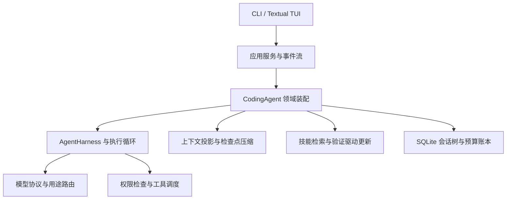

<div align="center">

# Weyra

### 面向持续任务与技能演进的轻量 Python Agent Harness

[](https://www.python.org/)
[](LICENSE)
[](docs/BENCHMARKS.md)
[](docs/USER_GUIDE.md)

**可追溯执行 · 缓存友好上下文 · 请求前预算治理 · 验证驱动技能更新**

</div>

Weyra 把模型推理、工具执行、会话状态和技能演进组织成一套可以持续运行、检查与扩展的工程系统。它融合 Pi、DeepSeek Harness、Hermes 的设计思路，并将 WikiSkill、SkillOpt 的经验积累与技能优化方法落地到原生 Python 异步运行时。

项目的核心价值是让长程任务拥有完整的运行闭环：每次模型调用有预算约束，每次工具操作有权限检查，每段历史有持久化记录，每次技能更新有验证依据。清晰的 `llm → core → coding → service → UI` 分层适合个人 Agent、编码助手与领域应用的二次开发。

## 核心能力

- **完整执行内核**：模型与工具循环、有限重试、取消传播、工具调用配对修复，以及 steering / follow-up 双队列。
- **长上下文工程**：结构化检查点压缩、Usage Anchor 动态校准、工具大结果中间剪枝与全文产物外置；稳定提示词前缀支持服务端缓存复用。
- **持久化会话树**：SQLite WAL 与追加式事件日志保存消息、调用和账本；支持恢复、分支、派生及上下文清空。
- **工具执行治理**：JSON Schema 参数校验、项目路径检查、读写协调和审批后策略重检；MCP 服务需显式信任。
- **请求前预算治理**：Token、调用次数及人民币预算预留；按返回 Usage 结算，未知消耗保守记账，父子任务共享预算约束。
- **验证驱动的技能更新**：将经验、知识与技能分开组织；有界文本补丁经过独立临时工作区重执行、硬断言与次序交换匿名裁判，再决定发布或拒绝，保留版本快照和回滚记录。
- **多协议与双界面**：OpenAI-compatible、Anthropic-compatible 模型适配，流式 CLI 与 Textual TUI，以及可嵌入的 Python 服务接口。

## 工程结果

| 场景 | 结果 | 对应价值 |
| --- | --- | --- |
| Polyglot Python / JavaScript 64 题累计反馈修复 | **50/64，78.1%**；Python **28/32，87.5%** | 展示受预算约束的工具执行与测试反馈闭环 |
| 对 35 道待修复题继续运行 | **新增通过 21 题，60.0%** | 通过失败反馈持续推进任务 |
| 技能定位配对评测：24 个任务、各重复两次 | **54.2% → 83.3%**；14 胜、0 负、34 平 | 改善技能选择与不匹配任务的弃权决策 |

Polyglot 结果采用累计保留与多轮修复协议，主输出上限为 4096 token，配置主模型 `DeepSeek-V4.1-Flash` 和备用路由；累计费用按配置费率保守估算约 ¥49.49，平均约 ¥0.77/题。协议、子集范围和结果摘要见 [评测说明](docs/BENCHMARKS.md) 与 [公开证据](docs/evidence/README.md)。

## 系统结构



目录：`weyra/llm` 负责协议，`weyra/core` 负责执行契约，`weyra/coding` 装配领域能力，`weyra/service.py` 提供应用服务，`weyra/tui` 提供终端界面。核心测试位于 `tests/`，离线示例位于 `examples/`。

## 快速上手

Python 3.11+，推荐 macOS / Linux。

```bash
python3 -m venv .venv
source .venv/bin/activate
python -m pip install -e '.[dev,tui]'

# 无需密钥，体验真实本地工具链和预设模型响应
weyra demo --scenario analysis --offline --project /tmp/weyra-analysis
weyra demo --scenario writing --offline --project /tmp/weyra-writing
weyra eval --offline --project /tmp/weyra-eval
```

配置真实模型：

```bash
cp weyra.example.toml weyra.toml
cp .env.example .env
# 在 .env 中填写密钥；按实际端点配置 weyra.toml
weyra check-config --project .
weyra --project .
weyra --project . --ui tui
weyra "阅读项目并总结核心执行链路" --project .
```

常用指令：`/cost` 查看费用与计费依据；`/plan on|off` 切换计划权限；`/compact` 压缩上下文；`/clear` 清空活动上下文并保留历史与账本；`/branch`、`/fork` 管理会话；`/skills` 与 `/skill-rollback` 管理技能。权限模式和 Shell 执行范围见 [使用指南](docs/USER_GUIDE.md)。

## 验证与开发

```bash
python -m pytest -q
ruff check .
python -m build
python scripts/verify_package.py
python -m examples.sdk_service
```

离线演示验证运行链路；在线任务能力与性能按对应协议评测。测试数量随版本变化，以当前完整测试输出为准。

## 文档与来源

- [架构与执行链路](docs/ARCHITECTURE.md)
- [框架借鉴与项目贡献](docs/FRAMEWORK_COMPARISON.md)
- [技能演进机制](docs/SKILL_EVOLUTION.md)
- [评测结果与协议](docs/BENCHMARKS.md)
- [使用指南](docs/USER_GUIDE.md)、[CLI / TUI](docs/CLI_TUI_REFERENCE.md)
- [Python API](docs/API_REFERENCE.md)、[配置参考](docs/CONFIGURATION_REFERENCE.md)
- [论文与实现映射](paper/README.md)、[贡献指南](CONTRIBUTING.md)

WikiSkill 和 SkillOpt 的引用采用其 2026 年 arXiv 版本。框架机制的来源与 Weyra 的集成贡献分别说明；接口组件、保留的 DSH 提示词及其第三方版权与 MIT 许可见 [第三方声明](THIRD_PARTY_NOTICES.md)。Weyra 采用 [MIT License](LICENSE)。
