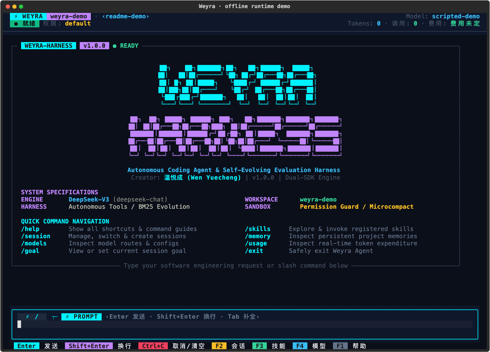
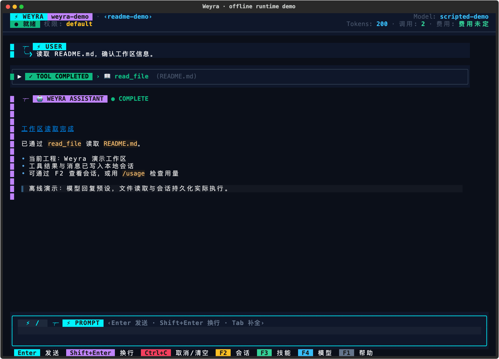
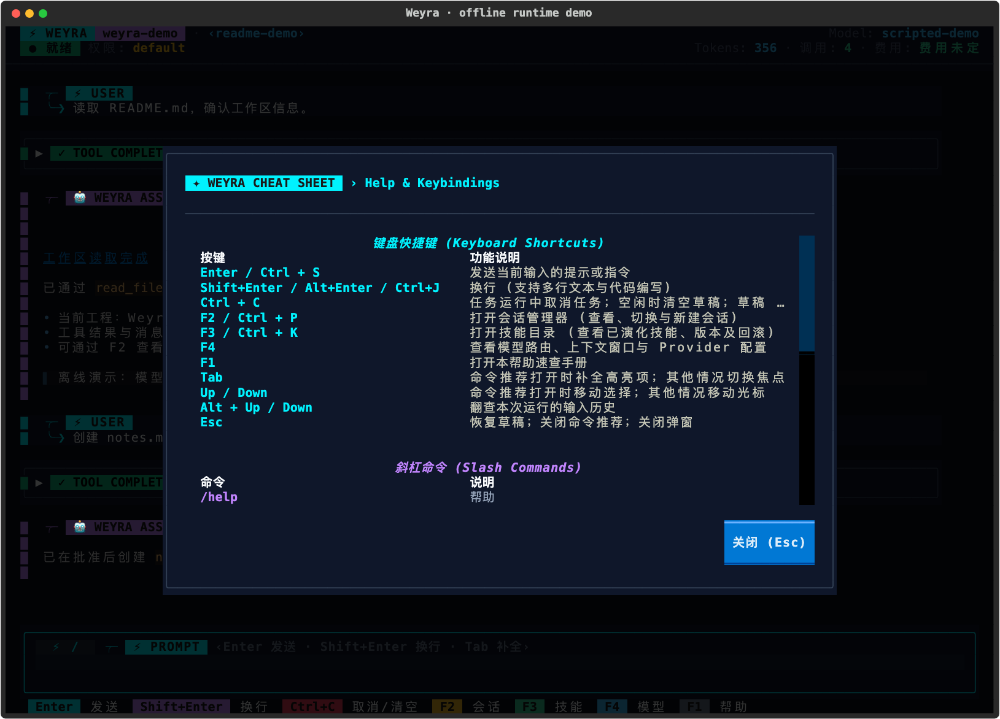

<div align="center">

# Weyra

### 面向持续任务与技能演进的轻量 Python Agent Harness

[](https://www.python.org/)
[](LICENSE)
[](https://github.com/WenYuecheng/Weyra/actions/workflows/ci.yml)
[](#实际运行截图)

**可追溯执行 · 长上下文管理 · 请求前预算治理 · 验证驱动技能更新**

</div>

Weyra 将模型推理、工具执行、会话状态和技能演进组织成可持续运行的 Python Agent 系统。终端界面提供对话、工具卡片、权限审批和会话管理；后端负责执行循环、模型协议适配、上下文压缩、预算记账和持久化。

界面层由 **流式 CLI 和 Textual TUI** 构成，通过 `WeyraAppService` 与后端交互。所有界面、应用服务和运行时源码均包含在本仓库中，可在本地安装运行。

## 实际运行截图

以下图片来自本仓库 Textual 应用的实际运行，通过临时工作区完成文件读取、写入审批与会话持久化后导出。演示使用预设模型响应，无需 API 密钥；工具操作、服务事件和界面交互由真实应用执行。

### 主界面

支持多行输入、斜杠命令推荐、状态栏及快捷键导航。



### 文件读取与工具结果

在输入区提交任务后，后端读取演示工作区的 `README.md`，界面展示工具执行结果和 Markdown 回复。



### 写入审批

默认权限模式下，创建 `notes.md` 前弹出审批窗口，展示工具名称和参数；批准后才实际写入文件。


### 会话管理

按 `F2` 或 `Ctrl+P` 打开会话列表，查看消息数、当前会话及更新时间，也可新建会话。


<details>
<summary>查看快捷键与命令帮助截图</summary>



</details>

## 核心能力

- **执行循环**：模型调用、工具执行、有限重试、取消传播，以及 steering / follow-up 双队列。
- **工具治理**：JSON Schema 参数校验、项目路径检查、读写协调、审批后策略重检，以及可选的多文件 patch。
- **长上下文管理**：结构化检查点压缩、Usage Anchor 动态校准、工具大结果中间剪枝和全文产物外置。
- **会话与任务恢复**：SQLite WAL、追加式事件日志、会话树与独立领域投影，支持恢复、分支和派生。
- **预算管理**：模型请求前预留 Token、调用次数及费用，按返回 Usage 结算，父子任务共享预算约束。
- **技能演进**：技能发现、检索、版本快照、验证门禁与回滚。自动演进默认关闭，开启时需要自行提供独立裁判和验证集。
- **模型接入**：OpenAI-compatible 与 Anthropic-compatible 协议，按主任务、压缩、记忆和演进等用途配置路由。
- **应用接口**：`WeyraAppService` 提供提交、取消、状态快照、历史查询和事件订阅，可嵌入自己的 Python 应用。

## 快速上手

需要 Python 3.11+，推荐 macOS / Linux。

```bash
git clone https://github.com/WenYuecheng/Weyra.git
cd Weyra
python3 -m venv .venv
source .venv/bin/activate
python -m pip install -e '.[tui]'
```

### 无密钥体验

```bash
# 流式 CLI：执行真实文件读取并输出结果
weyra --demo --project /tmp/weyra-cli-demo

# 全屏 TUI：在终端中启动后输入任务
weyra --demo --ui tui --project /tmp/weyra-tui-demo

# 多步骤离线场景
weyra demo --scenario analysis --offline --project /tmp/weyra-analysis
weyra demo --scenario writing --offline --project /tmp/weyra-writing

# Python 应用服务示例
python -m examples.sdk_service
```

TUI 离线模式启动后，可输入“读取 `.weyra/demo-fixture.txt` 并报告结果”体验一次完整工具调用。离线响应是固定脚本；持续自由对话需要配置真实模型。

### 接入真实模型

```bash
cp weyra.example.toml weyra.toml
cp .env.example .env
# 在 .env 中填写密钥，在 weyra.toml 中配置端点和模型容量
weyra check-config --project .

# 启动交互界面，或直接执行一次任务
weyra --project . --ui tui
weyra "阅读项目并总结核心执行链路" --project .
```

配置模板默认使用 DeepSeek 的 OpenAI 兼容协议。接入其他端点时，修改 `providers` 的 `protocol`、`base_url`、`api_key_env`，以及 `routes.main` 的模型、上下文容量和输出上限。密钥存放在 `.env`，个人路由存放在 `weyra.toml`，两者均被忽略。模板详见 [weyra.example.toml](weyra.example.toml) 和 [.env.example](.env.example)。

### 常用操作

| 操作 | 入口 |
| --- | --- |
| 发送 / 换行 | `Enter` / `Shift+Enter` |
| 查看帮助 | `F1` 或 `/help` |
| 管理会话 | `F2`、`Ctrl+P` 或 `/sessions` |
| 查看技能 | `F3`、`Ctrl+K` 或 `/skills` |
| 查看模型路由 | `F4` 或 `/models` |
| 用量与费用 | `/usage`、`/cost` |
| 计划权限模式 | `/plan on`、`/plan off` |
| 压缩 / 清空活动上下文 | `/compact` / `/clear` |
| 分支 / 派生 | `/branch`、`/fork` |
| 目标恢复 / 重新开始 | `/goal resume` / `/goal restart` |
| 取消任务 / 清空草稿 / 退出 | `Ctrl+C`，根据当前状态执行 |

默认权限模式会对需要授权的操作发起审批。会话数据库、记忆、技能版本及工具产物在目标工程的 `.weyra/` 下生成。

## 最新评测

2026 年 11 月 24 日的 Aider Polyglot 同题对照中，在 Python、Go、Rust、C++、Java 的 168 道最终有效配对题上，Weyra 两轮累计通过 **122/168（72.62%）**，基线通过 **110/168（65.48%）**，相差 **12 题、7.14 个百分点**。首轮有效配对为 170 道，Weyra 通过 50 题，基线通过 52 题。各自首轮失败后的修复率为 **75/123（60.98%）** 和 **61/121（50.41%）**。

[逐语言结果与复算方法](benchmarks/polyglot/README.md)

## 代码结构

```text
weyra/
├── llm/                 模型协议、类型与目录
├── core/                执行循环、步骤、上下文、工具准入与预算
├── coding/              编程领域装配及生命周期
├── service.py           应用服务、状态快照与事件订阅
├── session.py           SQLite 会话树与持久化
├── goals.py             持续任务目标与恢复
├── skills.py            技能发现、检索与加载
├── skill_evolution.py   技能候选、版本和回滚
├── skill_judge.py       独立验证门禁
├── tui/                 Textual 界面、组件、弹窗和主题
├── ui.py                流式 CLI 展示
└── main.py              应用启动入口
examples/                离线场景及 Python 服务示例
scripts/                 源码运行检查与截图复现
```

调用链为 `CLI / TUI → WeyraAppService → CodingAgent → AgentHarness → 模型 / 工具`。会话、目标、技能与预算通过后端服务协调，界面消费事件与状态快照。

## 安装验证与截图复现

```bash
python -m pip install -e '.[dev,tui]'
python -m ruff check weyra scripts/verify_source.py scripts/capture_readme.py
python scripts/verify_source.py
python -m build

# 重新运行界面并生成 README 的 PNG 截图
python -m pip install -e '.[tui,screenshots]'
python -m playwright install chromium
python scripts/capture_readme.py
```

CI 检查源码、CLI、离线演示、TUI 与应用服务，并构建和安装应用包。运行检查使用临时目录，无需仓库外的数据或在线模型。

## 发布内容与许可

仓库包含应用界面、后端运行时、安装配置、使用示例、README 截图及最新 Polyglot 评测的公开判定数据和复算代码。安装包提供应用运行所需的源码与资源。

Weyra 参考 Pi、DeepSeek Harness、Hermes 的运行时设计，并结合技能知识组织与验证驱动更新机制。适配接口和保留的 DeepSeek Harness 检查点提示词，其版权与许可见 [第三方声明](THIRD_PARTY_NOTICES.md)。项目采用 [MIT License](LICENSE)。
