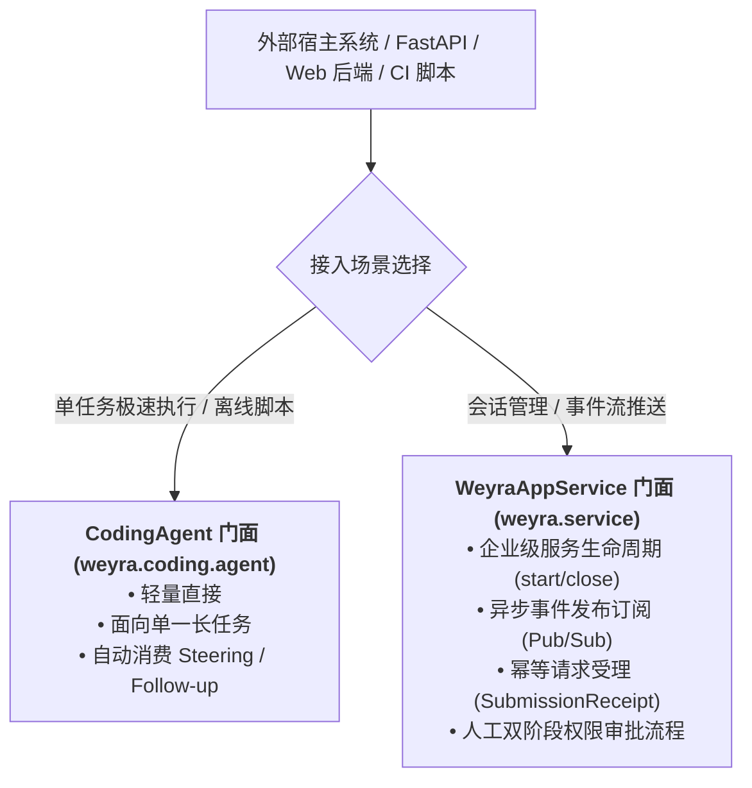
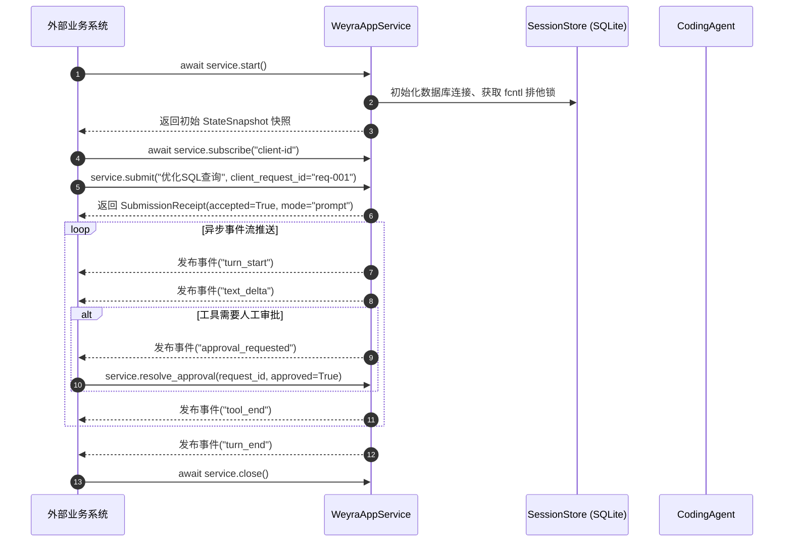

# Weyra Python SDK 编程式开发与 API 参考手册 (Python API Reference)

> **API 参考手册**：Weyra 提供了极简且强大的分层 Python API，涵盖面向任务执行的领域智能体门面 `CodingAgent`、面向企业级应用集成的统一服务门面 `WeyraAppService`、5 大全生命周期 Hook 插件体系以及 `SessionStore` 事件溯源底层接口。

---

## 目录 (Table of Contents)

- [一、 架构分层与 API 门面选择](#一-架构分层与-api-门面选择)
- [二、 编程式任务执行：`CodingAgent`](#二-编程式任务执行codingagent)
- [三、 企业级应用服务门面：`WeyraAppService`](#三-企业级应用服务门面weyraappservice)
- [四、 异步事件流订阅与数据契约 (`events.py`)](#四-异步事件流订阅与数据契约-eventspy)
- [五、 5 大全生命周期 Hook 插件体系](#五-5-大全生命周期-hook-插件体系)
- [六、 底层状态引擎接口：`SessionStore`](#六-底层状态引擎接口sessionstore)
- [七、 核心异常定义与处理字典](#七-核心异常定义与处理字典)

---

## 一、 架构分层与 API 门面选择

Weyra 的 API 按照调用复杂度与控制粒度设计为双层体系：



---

## 二、 编程式任务执行：`CodingAgent`

`CodingAgent` 是面向编码领域的纯核心门面，封装了项目规则、记忆检索、技能发现与双队列循环。

### 2.1 极速入门代码示例
```python
import asyncio
from pathlib import Path
from weyra.config import load_config
from weyra.coding.agent import CodingAgent

async def main():
    project_dir = Path.cwd()
    runtime = load_config(project_dir).build_runtime()

    agent = CodingAgent(
        project=project_dir,
        runtime=runtime,
        permission_mode="default",
        max_steps=40,
    )
    try:
        # 执行单轮或多轮任务 (自动处理工具调用与追问)
        answer = await agent.run_once("分析当前仓库结构并撰写核心技术概述")
        print("Agent 执行完成:\n", answer)
    finally:
        await agent.close()

if __name__ == "__main__":
    asyncio.run(main())
```

### 2.2 `CodingAgent` 构造参数与方法契约

| 方法签名 | 返回类型 | 功能语义与核心契约 |
| :--- | :--- | :--- |
| `await agent.run_once(prompt)` | `str` | 启动单次 ReAct 循环，消费所有排队追问，返回模型终态文本。 |
| `agent.steer(text)` | `str` (item_id) | 向 Pi 风格 Steering 队列插入即时纠偏指令，在当前工具步结束后立即介入。 |
| `agent.follow_up(text)` | `str` (item_id) | 向 Pi 风格 Follow-up 队列追加跟进任务，待整轮结束后自动开启新轮次。 |
| `await agent.resume_pending()` | `str` | 自动消费并执行此前崩溃重启后遗留的未消费排队追问。 |
| `agent.abort()` | `None` | 向当前正在运行的轮次派发优雅打断取消信号。 |
| `await agent.compact()` | `bool` | 手动执行 DSH 8 节结构化检查点提炼，返回是否成功缩减。 |
| `agent.clear_session()` | `None` | 安全清空当前视窗，保留底层的不可变事件日志与累计财务账本。 |
| `agent.branch(record_id)` | `str` (leaf_id) | 切换会话树活动叶子指针，秒级实现分支切换。 |
| `await agent.spawn_child(mode="spawn")` | `CodingAgent` | 派生子智能体，spawn 使用空上下文；fork 使用父级已完成投影，均共享项目与父级预算。 |
| `await agent.close()` | `None` | 释放 SQLite 锁句柄与模型运行时连接。 |

---

## 三、 企业级应用服务门面：`WeyraAppService`

`WeyraAppService` 是生产级 Web 服务、桌面客户端与微服务集成的统一入口。



### 3.1 核心服务方法字典

| 方法签名 | 返回类型 | 核心功能与参数说明 |
| :--- | :--- | :--- |
| `await service.start()` | `StateSnapshot` | 启动服务，加载当前项目会话树，返回当前状态快照。 |
| `await service.submit(text, *, mode="auto", client_request_id)` | `SubmissionReceipt` | 幂等提交用户需求指令。`client_request_id` 用于防重幂等校验。 |
| `await service.execute_command(line, *, client_request_id)` | `CommandResult` | 执行斜杠控制指令（如 `/plan on`, `/compact`, `/clear` 等）。 |
| `await service.cancel_turn()` | `CommandResult` | 取消当前正在执行的任务轮次（触发三段式中断）。 |
| `await service.get_snapshot()` | `StateSnapshot` | 获取当前会话状态、活跃模型、预算消耗与未决审批的完整镜像。 |
| `await service.list_sessions()` | `list[SessionSummary]` | 列出当前项目下的所有历史会话摘要（包含更新时间、消息数与活动叶节点）。 |
| `await service.open_session(session_id)` | `StateSnapshot` | 切换打开指定会话，释放旧会话资源并对新会话申请写锁。 |
| `await service.new_session()` | `StateSnapshot` | 新建全新根会话并挂载。 |
| `await service.subscribe(subscriber_id=None)` | `(StateSnapshot, Subscription)` | 注册异步事件监听队列，获得事件订阅器。 |
| `service.unsubscribe(subscriber_id)` | `bool` | 解除指定订阅器的事件流监听。 |
| `await service.resolve_approval(request_id, approved)` | `CommandResult` | 决议处于挂起状态的敏感工具调用审批（同意/拒绝）。 |
| `await service.close()` | `CommandResult` | 安全清理所有订阅、终止所有后台子任务并释放排他文件锁。 |

---

## 四、 异步事件流订阅与数据契约 (`events.py`)

### 4.1 核心状态快照实体 (`StateSnapshot`)
```python
from dataclasses import dataclass
from typing import Any

@dataclass
class StateSnapshot:
    schema_version: int
    service_id: str
    through_seq: int
    session_generation: int
    project: dict[str, str]
    session: dict[str, Any]  # session_id / leaf 等会话信息
    routes: dict[str, Any]
    permission_mode: str
    lifecycle: str
    activity: str  # idle / generating / executing_tools / awaiting_approval 等
    budget: dict[str, Any]
    pending_inputs: list[dict[str, Any]]
    pending_approvals: list[dict[str, Any]]
    background: dict[str, Any]
    last_outcome: str | None
```

### 4.2 核心生命周期事件字典清单

| 事件类型 (`kind`) | 携带数据核心字段 (`data`) | 触发场景 |
| --- | --- | --- |
| `turn_start` | `prompt` | 服务接纳新的任务轮次 |
| `text_delta` | `delta` | 正文增量 |
| `thinking_delta` | `delta` | 思考增量（视提供商支持） |
| `approval_requested` | `request_id`, `name`, `arguments`, `permission` | 请求人工审批 |
| `tool_start` | `call_id`, `name`, `arguments` | 工具获准执行 |
| `tool_end` | `call_id`, `status`, `name`, `result`, `artifact_path` | 工具完成 |
| `compaction_start` / `compaction_end` | 该次压缩的数据载荷 | 压缩生命周期 |
| `state_changed` | StateSnapshot 的序列化字段 | 状态同步；预算在 budget 字段中 |
| `turn_end` | `turn_id`, `state` | completed / incomplete / failed / cancelled |

`budget_checkpoint` 是持久化账本事件，不是上述前端订阅事件的别名。

---

## 五、 5 大全生命周期 Hook 插件体系

Weyra 在 `weyra.core.hooks` 中提供了强契约的 Hook 注册管道：

```python
from weyra.core.hooks import (
    UserInputHook,
    AgentStartHook,
    BeforeModelCallHook,
    ToolCallHook,
    ToolResultHook,
    HookResult,
)

# 1. 拦截用户输入 (修改输入文本或安全阻断)
agent.hooks.register(
    UserInputHook,
    lambda payload: HookResult(block=True, reason="请求需要人工复核")
    if "rm -rf" in payload.input_text else HookResult()
)

# 2. 轮次启动前动态注入额外系统规则 (轮次覆写不污染底层基线)
agent.hooks.register(
    AgentStartHook,
    lambda payload: HookResult(updated_system_prompt=payload.system_prompt + "\n请以 Python 架构师风格回答。")
)

# 3. 工具执行前参数重定向
agent.hooks.register(
    ToolCallHook,
    lambda payload: HookResult(updated_args={**payload.args, "path": "safe/path.py"})
    if payload.tool_name == "read_file" else HookResult()
)
```

---

## 六、 底层状态引擎接口：`SessionStore`

位于 `weyra/session.py`，负责不可变事件树 DAG 与 SQLite 物理交互：

```python
from weyra.session import SessionStore

# 实例化会话引擎 (自动开启 SQLite WAL 与 fcntl 排他锁)
store = SessionStore(project=".", session_id="my-session-001")

try:
    # 1. 追加不可变事件
    from weyra.contracts import Message
    event = store.add_message(Message("user", "Hello Agent"))
    print(f"写入事件 ID: {event['id']}, 父事件 ID: {event['parent']}")

    # 2. 从指定叶节点投影出完整消息历史
    messages = store.project(leaf=store.leaf)

    # 3. 崩溃自愈恢复未闭合工具调用
    store.recover_interrupted()

    # 4. 派生独立会话分支
    forked_store = store.fork(session_id="experiment-branch")
    forked_store.close()

finally:
    store.close()
```

---

## 七、 核心异常定义与处理字典

| 异常类名 | 所属模块 | 抛出原因与工业级处理指引 |
| :--- | :--- | :--- |
| **`SessionError`** | `weyra.session` | 发生跨目录逃逸、符号链接越权、或会话已被其他写入者独占加锁。应捕获并提示用户检查并发冲突。 |
| **`BudgetExceeded`** | `weyra.core.state` | 消耗达到配置的 Token 上限、调用次数或人民币金额硬上限。Fail-Closed 立即熔断。需提示用户调大预算或结束任务。 |
| **`ContextOverflow`** | `weyra.core.context`| 上下文切割割裂了成对工具拓扑，或压缩后内容依然超出模型硬上限。应调用 `/clear` 刷新视窗。 |
| **`PermissionError`** | Python 内置异常| 在只读计划模式或未获审批的情况下尝试调用非只读写入工具。系统自动阻断该工具执行。 |

可直接运行的完整服务订阅示例见 [examples/sdk_service.py](../examples/sdk_service.py)，通过 `turn_end` 等待完成。
