# Weyra 系统全景架构与工业级核心微内核白皮书 (System Architecture & Microkernel Whitepaper)

> **文档定位**：本文档为 **Weyra** 自主编码智能体系统的官方核心技术白皮书与架构工程实现指南。
> 系统性阐述了基于 **Pi Agent 极简纯函数 ReAct 微内核**（Session Tree DAG 树形事件溯源、Steering/Follow-up 双队列优先级调度、成对工具抗 400 防御、TTY 单输入源协同）、**DeepSeek-Harness 工业级工程规约**（DSH 8 节结构化检查点压缩、8192 字符中间修剪、Fail-Closed 预算硬防护与微美分结算、POSIX 进程组隔离与多读单写协调锁）、**Anthropic/Pi 4 阶段 Prompt Cache 前缀对齐** 以及 **基于 WikiSkill/SkillOpt 的自进化技能与双盲仲裁门禁** 的完整设计思想、数学推导与全栈源码落地。
>
> 适用于底层架构师、智能体研发工程师以及开源核心贡献者的系统化技术参考。

---

## 目录 (Table of Contents)

- [第一章：五层解耦拓扑与全景系统架构](#第一章五层解耦拓扑与全景系统架构)
- [第二章：Pi Agent 纯函数 ReAct 微内核与执行流](#第二章pi-agent-纯函数-react-微内核与执行流)
- [第三章：人类意图 Steering/Follow-up 双队列调度体系](#第三章人类意图-steeringfollow-up-双队列调度体系)
- [第四章：Anthropic/Pi 4 阶段 Prompt Cache 前缀对齐与 KV 缓存机制](#第四章anthropicpi-4-阶段-prompt-cache-前缀对齐与-kv-缓存机制)
- [第五章：DeepSeek-Harness 八节结构化压缩算法与数学模型](#第五章deepseek-harness-八节结构化压缩算法与数学模型)
- [第六章：Session Tree DAG 树状事件溯源与 SQLite WAL 并发架构](#第六章session-tree-dag-树状事件溯源与-sqlite-wal-并发架构)
- [第七章：成对工具抗 400 防御与大文本中间修剪（Middle Pruning）](#第七章成对工具抗-400-防御与大文本中间修剪middle-pruning)
- [第八章：Fail-Closed 预算守卫、两阶段预留锁与金融级精算](#第八章fail-closed-预算守卫两阶段预留锁与金融级精算)
- [第九章：TTY 终端协同、三段式 Ctrl+C 中断与 POSIX 进程治理](#第九章tty-终端协同三段式-ctrlc-中断与-posix-进程治理)
- [第十章：自进化技能系统、有界补丁与顺序交换双盲仲裁](#第十章自进化技能系统有界补丁与顺序交换双盲仲裁)
- [结语：工业级自主智能体的设计哲学](#结语工业级自主智能体的设计哲学)

---

## 第一章：五层解耦拓扑与全景系统架构

### 1.1 系统总体分层模型 (Five-Plane Architecture)
Weyra 彻底摈弃了传统开源框架中将 Prompt 拼装、模型调用、状态存储与 UI 逻辑纠缠不清的单体设计，严格遵循“微内核、强契约、单向依赖”的原则，构建了清晰的五层解耦拓扑：

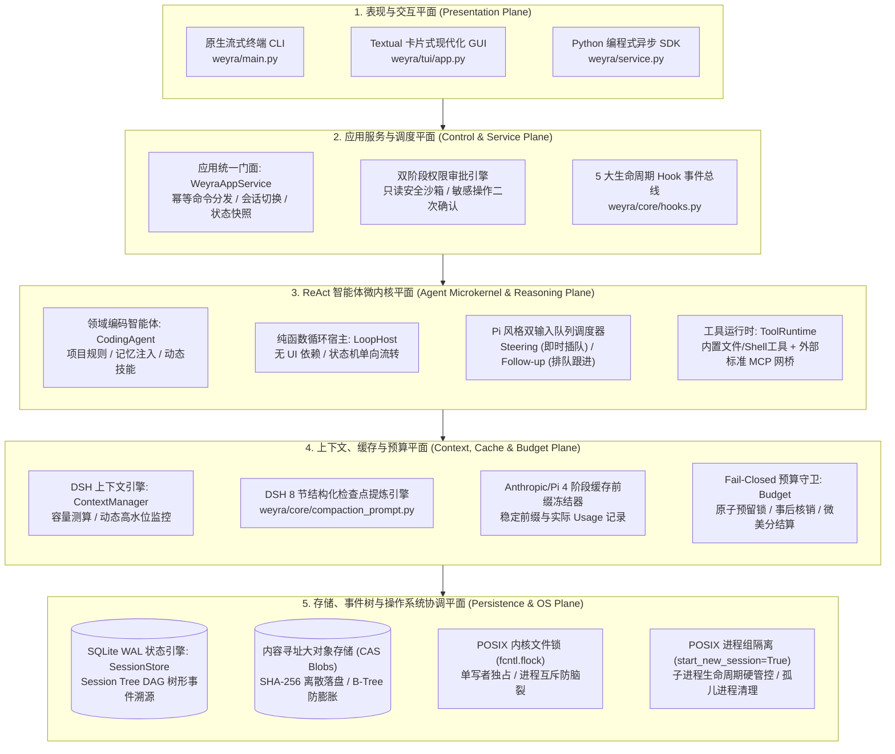

### 1.2 核心模块全景映射规范

| 物理分层 | 核心模块路径 | 架构设计职责 | 核心开源血统归属 |
| :--- | :--- | :--- | :--- |
| **表现平面** | `weyra/main.py`<br>`weyra/tui/` | 命令行参数解析、原生流式渲染、Textual 卡片组件、TTY 终端协同 | **Pi Agent** (单输入源 TTY 协调器) |
| **服务平面** | `weyra/service.py`<br>`weyra/events.py` | 统一会话生命周期调度、跨进程/线程异步发布订阅、双阶段审批路由 | **自主创新原创** |
| **内核平面** | `weyra/core/loop.py`<br>`weyra/coding/agent.py` | 纯函数 ReAct 单步推进、双队列调度、状态单调演进、模型调用解耦 | **Pi Agent** (ReAct 极简微内核) |
| **工具平面** | `weyra/tools.py`<br>`weyra/mcp_client.py` | 文件/系统工具、标准 Model Context Protocol (stdio) 客户端 | **DeepSeek-Harness** (工具沙箱) |
| **上下文平面** | `weyra/core/context.py`<br>`weyra/output.py` | 容量阈值方程、8192 字符中间修剪、成对工具抗 400 拓扑清洗、KV 缓存对齐 | **DeepSeek-Harness** + **Pi Agent** |
| **预算平面** | `weyra/core/state.py`<br>`weyra/pricing.py` | Fail-Closed 事前额度预留、原子回滚、事后 Usage 精确差额核销 | **DeepSeek-Harness** (预算守卫) |
| **持久化平面** | `weyra/session.py` | SQLite WAL 模式、不可变事件树 DAG、CAS 大对象落盘、`fcntl` 内核排他锁 | **Pi Agent** (Session Tree DAG) |
| **自进化平面** | `weyra/skill_evolution.py`<br>`weyra/skill_judge.py` | 局部有界语法补丁、隔离沙箱实测、顺序交换双盲 LLM 仲裁、零退化门禁 | **WikiSkill** + **SkillOpt** 学术落地 |

---

## 第二章：Pi Agent 纯函数 ReAct 微内核与执行流

### 2.1 ReAct 纯函数执行循环
Weyra 的核心智能体循环（`weyra/core/loop.py`）借鉴了 **Pi Agent** 的极简设计哲学：**将智能体的思考、规划、工具执行抽象为一个纯粹的状态机单步转移函数**。循环宿主 `LoopHost` 与具体的终端 UI 或网络协议完全解耦：

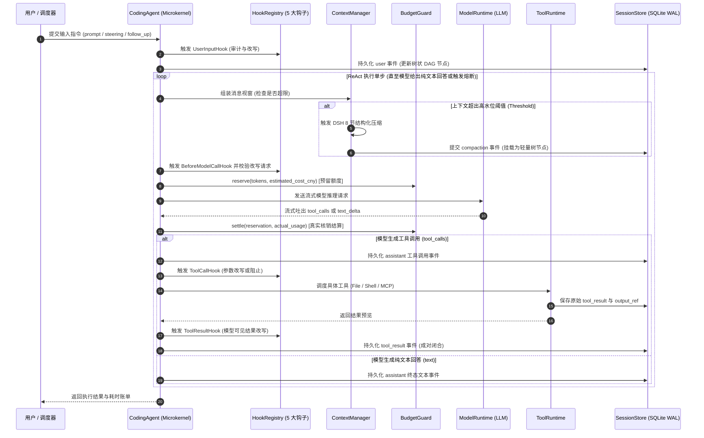

### 2.2 单步循环的核心不变性 (Kernel Invariants)
1. **原子步转移不变性**：每个推理步产生一个采纳的模型响应，底层允许有限重试与故障切换，产生明确的 `assistant` 事件；
2. **纯函数状态流转**：持久事实由 SessionStore 投影恢复；运行中的任务、锁与传输连接由宿主生命周期管理；
3. **确定性收敛保障**：单轮对话设置硬性循环步长上限（`max_steps`，默认 40 步），防止模型在遇到死循环工具报错时无限轮询，耗尽算力。

---

## 第三章：人类意图 Steering/Follow-up 双队列调度体系

在长程自主编码任务中，人类用户与智能体的交互并非单向等待。**Pi Agent** 最伟大的工程突破之一便是提出了**双输入队列并发调度体系（Dual Input Queues）**，彻底解决了长程任务中的“即时干预”与“批次排队”冲突：

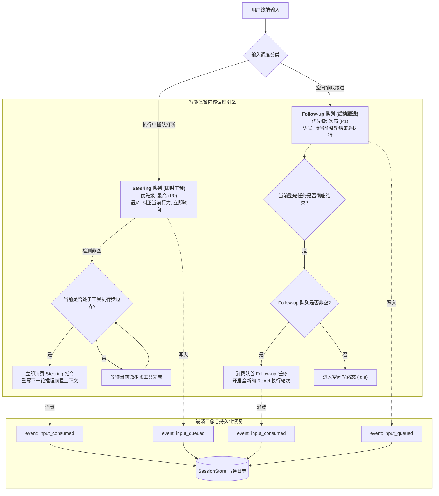

### 3.1 调度优先级数学模型
设当前系统时间戳为 $t$，队列调度器遵循严格的优先级序：
$$\text{Priority}(\text{Steering}) \succ \text{Priority}(\text{Tool Continuation}) \succ \text{Priority}(\text{Follow-up}) \succ \text{Priority}(\text{New Session Turn})$$

- **Steering（即时纠偏）**：当用户发现 Agent 正在修改错误的文件时输入，指令在当前工具步骤返回后的下一推理边界介入，阻断原定的下一步动作，强制模型根据新指令重新评估轨迹；
- **Follow-up（延后跟进）**：当用户希望在当前重构完成后接着运行测试时输入，任务进入 FIFO 先入先出队列，在当前 ReAct 循环完全处于终态时自动触发。
- **崩溃一致性保障**：队列中未消费的指令全部以 `input_queued` 事件持久化落盘；当进程意外崩溃重启时，Agent 自动全量重放未被 `input_consumed` 冲销的队列事件，恢复未被确认消费的输入项目。

---

## 第四章：Anthropic/Pi 4 阶段 Prompt Cache 前缀对齐与 KV 缓存机制

在大模型服务端推理中，**KV Cache 命中率是决定首字延迟（TTFT）与推理算力成本的命脉**。根据 Anthropic 与现代推理引擎（如 vLLM/SGLang）的缓存机制，缓存复用严格基于 Prompt 的最长公共前缀（Longest Common Prefix）。**只要前缀发生 1 个 Token 的改动，后续所有缓存全部瞬间失效**。

Weyra 遵循 Pi Agent 的前缀绝对神圣原则（*“Per-conversation prompt caching is sacred”*），构建了**最多 4 个缓存标记的请求布局**：

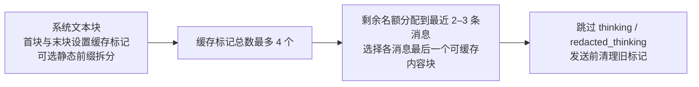

### 4.1 缓存复用的核验方式

`_anthropic_cache` 对系统块首尾和最近消息分配最多 4 个缓存标记，跳过思考签名块。静态前缀、确定性工具次序和动态事实分离共同支持缓存复用。命中率从实际 `cache_read_tokens / input_tokens` 计算，TTFT 使用逐请求计时，收益使用对应端点费率；本版不以固定命中率或固定延迟承诺替代运行记录。

---

## 第五章：DeepSeek-Harness 八节结构化压缩算法与数学模型

### 5.1 上下文容量测算与触发水位数学模型
当对话历史不断增长逼近物理视窗极限时，Weyra 启用了深度对齐 **DeepSeek-Harness (`packages/compaction/`)** 的动态触发方程：

设模型最大上下文物理容量为 $C$（`context_window`），模型单次最大输出预留 Token 为 $R$（`max_output_tokens`），系统安全缓冲 Token 为 $H$（`headroom_tokens`，默认 65,536），触发水位比例为 $\theta$（`threshold_ratio`，默认 0.8），保留窗口比例为 $\rho$（`retain_ratio`，默认 0.16）。

Weyra 定义**可用压力上限** $P$：
$$P = C - R - H$$

**自动压缩触发阈值（Trigger Threshold）**：
$$\text{Threshold} = \left\lfloor \min\left( C \times \theta, \; P \right) \right\rfloor$$

**压缩后保留最新原文窗口预算（Retain Budget）**：
$$\text{Retain} = \left\lfloor (C - R) \times \rho \right\rfloor$$

系统强制约束核心不变性：
$$\text{Retain} < \text{Threshold} \quad \text{且} \quad P > 0$$
若参数配置违反上述不等式，系统在启动初始化阶段立即抛出异常（Fail-Loud），坚决杜绝死循环压缩或窗口静默溢出。

### 5.2 DSH 8 节结构化检查点提炼流水线
当视窗内 Token 超过 $\text{Threshold}$ 时，系统绝不采用机械的尾部丢弃或滑动窗口截断，而是启动compression 用途路由（未配置时继承主模型）执行 **Commit `d743267` 锁定的 8 节结构化检查点生成**：

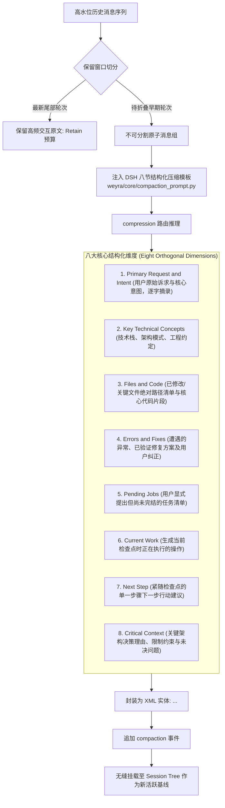

八节结构将目标、文件变更、错误和下一步行动明确组织为交接记录；完整原始历史保留在事件存储中，模型继续工作时使用摘要与保留尾部原文。

---

## 第六章：Session Tree DAG 树状事件溯源与 SQLite WAL 并发架构

传统智能体普遍采用线性消息数组存储历史，一旦用户希望“回退到上一状态重新推演”，线性结构将不得不暴力截断或覆盖数据，导致历史探索路径彻底丢失。

**Weyra 完整继承并原生落地了 Pi Agent 的不可变会话树 DAG（Session Tree DAG）**，结合底层 SQLite WAL 事务引擎与 POSIX 内核排他文件锁，构建了企业级高并发与时间旅行能力：

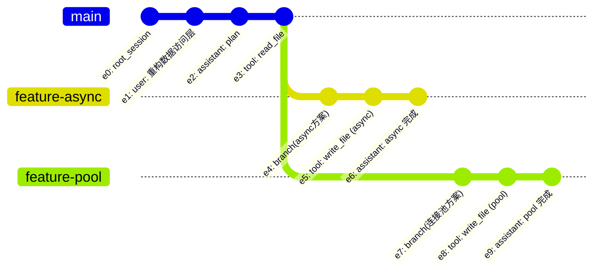

### 6.1 树状事件模型与时间旅行机制
- **数据表拓扑**：
  ```sql
  CREATE TABLE events (
      seq INTEGER PRIMARY KEY AUTOINCREMENT,
      session_id TEXT NOT NULL,
      id TEXT NOT NULL,
      parent TEXT,
      kind TEXT NOT NULL,
      data TEXT NOT NULL,
      request_id TEXT, task_id TEXT, turn_id TEXT,
      UNIQUE(session_id, id),
      FOREIGN KEY(session_id) REFERENCES sessions(session_id),
      FOREIGN KEY(session_id, parent) REFERENCES events(session_id, id)
  );
  ```
- **指针移动式分支**：`branch(record_id)` 校验祖先链与工具配对后移动活动叶节点并追加分支事件；既有事件保留。指针更新是常数操作，完整校验与投影随历史长度增长。
- **派生会话**：`fork()` 创建独立会话 ID，以当前消息投影写入 seed。CodingAgent 子任务另有自己的会话与上下文，并共享父级预算约束。

### 6.2 SQLite WAL 模式与 POSIX 内核级排他锁
为了支持企业级多进程并发调用并防止脑裂：
1. **SQLite WAL 调优**：
   - `PRAGMA journal_mode=WAL;`：读写互不阻塞，读操作不阻塞写，写操作不阻塞读；
   - `PRAGMA synchronous=FULL;`：按 FULL 同步策略提交，配合恢复流程管理中断状态；
   - `PRAGMA foreign_keys=ON;`：强制外键完整性约束，防止孤儿节点产生。
2. **内核级文件排他锁 (`fcntl.flock`)**：
   在写入任何会话前，必须首先在 `.weyra/locks/<sha256(session_id)>.lock` 上申请 `fcntl.flock(LOCK_EX | LOCK_NB)` 排他锁。若该会话正被另一个后台进程或 TUI 占用，非阻塞锁立即拒绝并抛出明确异常，坚决杜绝多写者并发破坏事务。
3. **内容寻址存储（CAS Blobs）**：
   model_request 的 system 与 tools 字段通过 SHA-256 存入 blobs 表，事件保留字段引用；工具原文另写入 artifacts 哈希文件，结果事件保存预览与 output_ref。该路径按事件字段与结果类型处理，不采用统一 1024 字节阈值。

---

## 第七章：成对工具抗 400 防御与大文本中间修剪（Middle Pruning）

### 7.1 成对工具抗 400 防御 (Anti-400 Tool Pairing Invariant)
在对接 OpenAI、Anthropic、DeepSeek 等商业模型 API 时，协议规定：**若 Assistant 消息携带了 `tool_calls`，后续消息流中必须紧随包含完全一致 `tool_call_id` 的 Tool Result 消息**。

若因中间截断、异常抛出或滑动窗口割裂导致产生孤立的 Tool 调用或孤立的 Tool 结果，模型服务端将直接返回 `HTTP 400 Bad Request`，导致整个长程任务雪崩中断。

Weyra 在 `weyra/core/context.py` 中实现了严格的**不可分割原子交互组（Interaction Group）**切分算法：

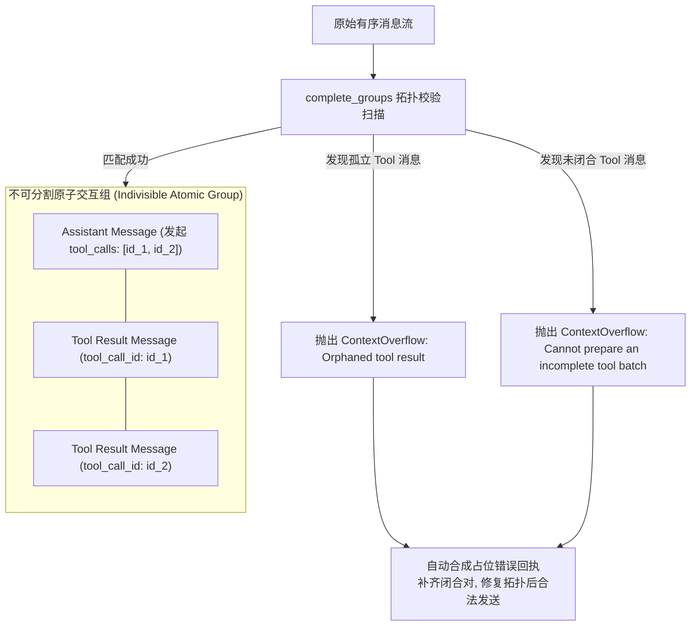

### 7.2 8192 字符中间修剪算法 (DeepSeek-Harness Middle Pruning)
当执行 `run_shell("cat huge_log.txt")` 或大型文件读取产生数十万字符的大型输出时，若全部灌入上下文将迅速撑爆视窗；若直接尾部截断则会丢失最终的执行退出状态。

Weyra 严格落地了 **DeepSeek-Harness 8192 字符中间修剪规约 (`weyra/output.py`)**：

```python
def prune_tool_result(content: str) -> str:
    # 严格 8192 Unicode 码点 水位线
    if len(content) <= 8192:
        return content
    # 保留头部 4096 字符 (命令启动、初始参数、前置环境)
    # 保留尾部 1024 字符 (最终结果、退出状态码、错误汇总)
    # 中间插入形式化省略标记，全量原文写入 .weyra/artifacts/
    return content[:4096] + "\n\n[... tool result middle pruned ...]\n\n" + content[-1024:]
```

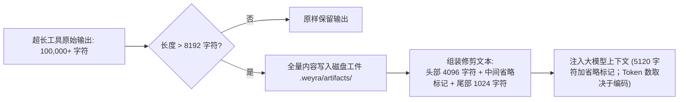

---

## 第八章：Fail-Closed 预算守卫、两阶段预留锁与金融级精算

在工业级生产环境中，大模型递归调用极易因失控循环导致用户账单在数秒内产生数千元不可逆巨额穿透。

Weyra 深度汲取 **DeepSeek-Harness (`packages/guard/`)** 的精髓，落地了金融级 **Fail-Closed 预算守卫体系 (`weyra/core/state.py`)**：

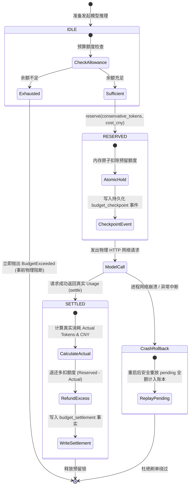

### 8.1 预留与结算方程
输入金额预留采用配置上下文容量与完整序列化请求字节上界的较大者；按最大适用输入费率预留。设该输入 Token 上界为 $N_{\text{in}}$，最大输出预估为 $N_{\text{out}}$，输入单价为 $P_{\text{in}}$（元/百万 Token），输出单价为 $P_{\text{out}}$，缓存读单价为 $P_{\text{cache}}=P_{\text{read}}$，缓存写单价为 $P_{\text{write}}$；未单独配置的输入分项在预留时按基础输入价处理。

1. **事前最保守预留金额（Reserved Cost）**：
   $$\text{Cost}_{\text{reserved}} = \frac{N_{\text{in}} \times \max(P_{\text{in}},P_{\text{read}},P_{\text{write}}) + N_{\text{out}} \times P_{\text{out}}}{10^6}$$
   只有当 $\text{Balance} \ge \text{Cost}_{\text{reserved}}$ 时，请求才被允许发出；
2. **事后结算金额（无独立缓存写入费时的简化式）**：
   $$\text{Cost}_{\text{actual}} = \frac{(N_{\text{prompt}} - N_{\text{cached}}) \times P_{\text{in}} + N_{\text{cached}} \times P_{\text{cache}} + N_{\text{completion}} \times P_{\text{out}}}{10^6}$$
3. **差额退款（Refund to Balance）**：
   $$\text{Refund} = \text{Cost}_{\text{reserved}} - \text{Cost}_{\text{actual}}$$

采用 Decimal 记录金额。缓存读写分段按配置费率结算，独立缓存写入另计；Usage 或费率不完整时保留保守金额与未知标记。机制验证入口见 `tests/test_budget_cost.py`。

---

## 第九章：TTY 终端协同、三段式 Ctrl+C 中断与 POSIX 进程治理

### 9.1 Pi Agent 三段式 Ctrl+C 终端打断状态机
在交互式终端中，暴力拦截 `SIGINT` 会导致进程瞬间死亡、正在写入的数据库锁未释放、后台子进程变成孤儿僵尸；而不拦截则无法中断模型的冗长输出。

Weyra 严谨落地了 **Pi Agent 交互式终端标准三段式打断模型（Pi Three-Phase Interrupt Model）**：

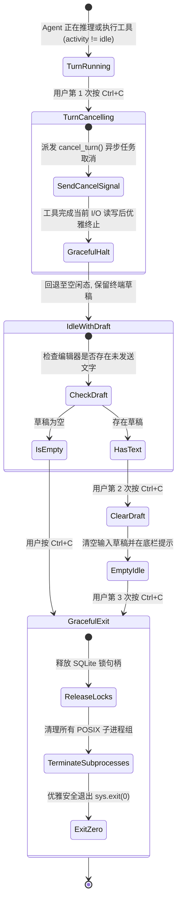

### 9.2 POSIX 进程组隔离与僵尸进程治理
当 Agent 执行复杂的外部命令（如 `pytest`、编译构建或微服务启动）时，若仅仅使用基础的 `subprocess.Popen`，父进程中断时子进程派生的孙子进程将沦为后台孤儿僵尸进程，持续霸占 CPU 与端口。

Weyra 落地了工业级 POSIX 进程治理：
- **独立进程会话组 (`start_new_session=True`)**：每个 Shell 命令派生在独立的进程组中；
- **原子信号广播 (`os.killpg`)**：超时或取消时，系统直接向进程组 ID 发送 `SIGTERM`，并在 2 秒超时未响应后升级为 `SIGKILL`，确保所有孙子进程被原子级扫除；
- **异步安全管道流**：Shell 作业将 stdout/stderr 重定向到磁盘日志，由作业管理器执行等待、取消与回收。

---

## 第十章：自进化技能系统、有界补丁与顺序交换双盲仲裁

Weyra 将 **WikiSkill (arXiv:2608.27454)** 与 **SkillOpt (arXiv:2605.23904)** 2026 年预印本方法，构建了**长程自进化闭环体系**：

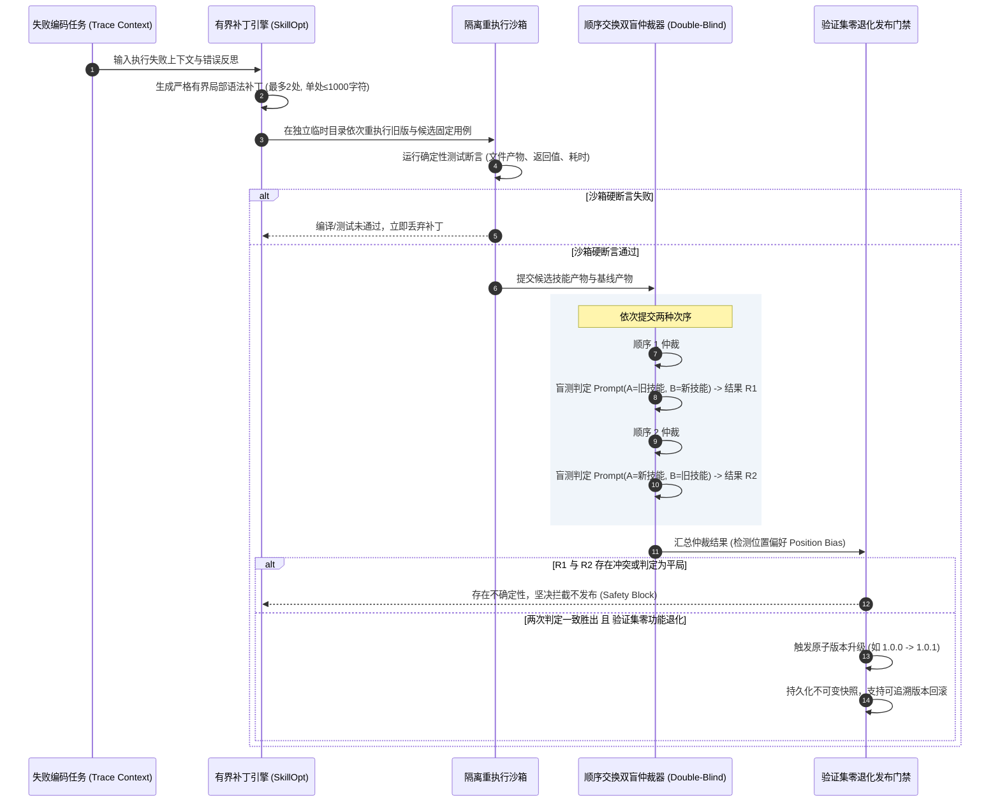

### 10.1 核心技术突破与工程超越
1. **彻底废除全量重写**：限制单次技能文档编辑的数量与大小，强制限定采用 **有界局部补丁（Bounded Text Patches）**；
2. **识别位置偏好并拒绝冲突结果（Position Bias）**：大模型裁判天然倾向于打高排在第一位（或第二位）的候选回答。Weyra 通过严格将新旧产物交换位置发起**两次独立双盲推理**；只要两次结果未达成一致（如正向判定 A 优于 B，但反向判定 B 优于 A），一律视为不确定性并坚决拦截；
3. **验证集零退化硬门禁**：新技能发布必须通过离线全量黄金验证集检验，只有在成功数严格增加且硬失败数不增加时才允许并入正式库，在固定验证任务上检查候选改进与硬约束。

---

## 结语：工业级自主智能体的设计哲学

Weyra 的架构演进证明了一条深刻的工程真理：**优秀的自主智能体不仅取决于底层大模型的基座智商，更取决于支撑其长程运行的操作系统级内核体系**。

通过将 **Pi Agent 的纯函数 ReAct 微内核、双队列与不可变树状事件日志**、**DeepSeek-Harness 的 8 节结构化压缩、中间修剪与 Fail-Closed 预算防御**、**Anthropic 的 4 阶段 Prompt Cache 前缀对齐** 以及 **顶会自进化技能与双盲仲裁** 严密交融，Weyra 打造了一座高可用、高确定性、低成本且自主生长的工业级智能体灯塔。
