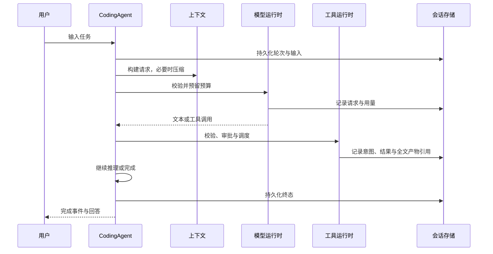

# 架构与执行链路

Weyra 将协议适配、任务执行、领域能力与界面解耦，使每次模型调用、工具副作用和状态变更都有明确归属。其工程重点是可检查的长程执行：在上下文、权限和预算约束下持续推进任务，并保留足以恢复与追溯的记录。

## 分层

| 层 | 主要模块 | 职责 |
| --- | --- | --- |
| 模型协议 | `weyra/llm/` | 厂商中立消息、请求与 Usage；OpenAI / Anthropic 协议转换 |
| 执行核心 | `weyra/core/` | 循环、模型步骤、工具步骤、Hook、上下文和预算契约 |
| 领域装配 | `weyra/coding/` | 项目规则、记忆、技能、子任务与会话生命周期 |
| 应用服务 | `weyra/service.py`, `events.py` | 幂等提交、事件订阅、审批、会话管理 |
| 表现层 | `weyra/main.py`, `weyra/tui/` | CLI 与 Textual 交互 |
| 持久化 | `weyra/session.py` | SQLite WAL、事件树、预算与调用记录 |

## 执行与扩展

纯循环 `run_agent_loop` 依赖 `LoopHost`，不直接绑定 UI。`AgentHarness` 提供运行状态、取消与观察者；`CodingAgent` 装配项目能力。循环返回回答字符串，并把 `completed` / `incomplete` 写入运行上下文。

输入先经过 `UserInputHook`，轮次开始经过 `AgentStartHook`；模型调用和工具调用前分别有拦截点。当前轮次的提示词覆写与持久化基线分离，改写后重新检查容量。steering 在步骤边界接纳，follow-up 在前轮结束后顺序执行。

## 上下文与缓存

静态系统基线与动态环境事实分开组织。工具输出保留紧凑预览，原文放入 `.weyra/artifacts/`；超过阈值时生成 DSH 风格八节检查点。Usage Anchor 结合本地估计与服务端用量调整压力判断；消息投影修复工具调用配对。

这些机制为缓存复用与长程运行提供结构条件。实际命中率、延迟和摘要保留质量由端点、任务及压缩结果决定。

## 持久化与恢复

事件以 `id` / `parent` 组织成树，由 `leaf` 确定活动分支。SQLite WAL 和事务协调持久化；清空上下文追加空 seed，保留原事件与账本。恢复接受历史 `id` 及当前 `turn_id` 轮次字段，为未闭合工具调用补充结果未知标记，避免自动重试非幂等操作。

`branch` 切换活动叶节点；`fork` 创建独立会话。存在活跃任务或技能维护时禁止直接清空或切换上下文。

## 权限、预算与资源

工具调用经过模式校验、读写调度和审批后策略重检。子任务继承父级权限约束并共享预算。Shell 使用独立进程组，由作业所有者管理取消和回收；该机制负责进程治理，容器隔离由部署环境提供。

请求发出前预留调用、Token 和可配置金额预算。返回完整 Usage 时结算，否则保留估算费用与未知标记。计价使用 Decimal，精确账单与保守上界分开呈现。

## 技能演进

Weyra 将经验积累与可执行技能修改分开处理。有界文本补丁经过固定任务重执行、硬断言和次序交换匿名比较，再决定是否发布。版本快照、预备记录和恢复逻辑支撑回滚与异常恢复。详见[技能机制](SKILL_EVOLUTION.md)和[来源映射](FRAMEWORK_COMPARISON.md)。
