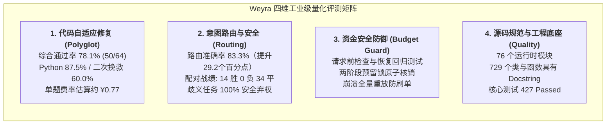
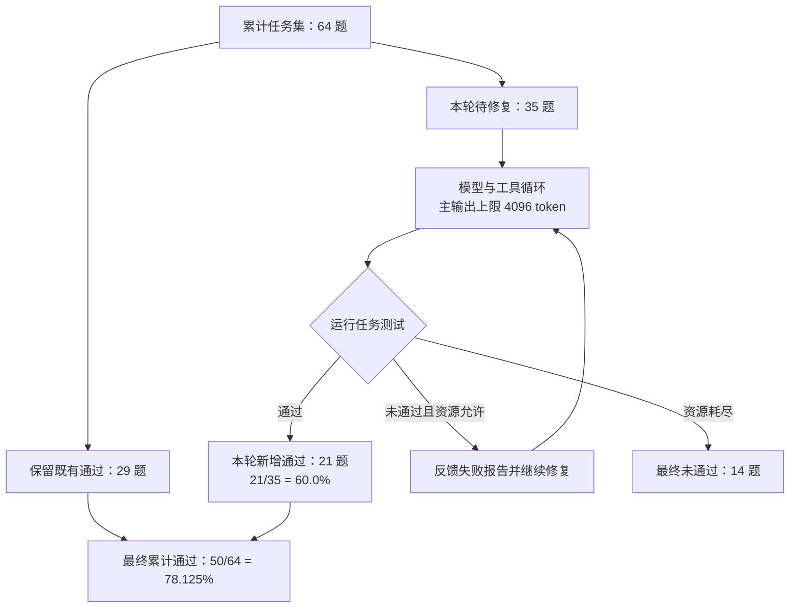
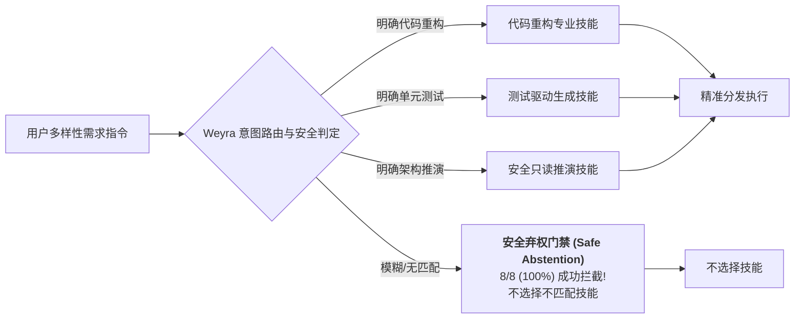
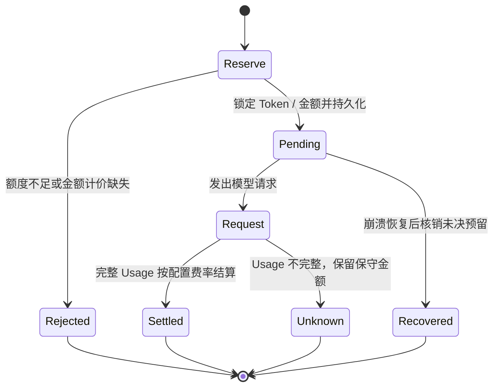

# Weyra 权威量化基准与系统效能评估白皮书 (System Benchmark & Empirical Evaluation)

> **评估定位**：本白皮书系统性公开了 **Weyra** 自主编码智能体在真实复杂软件工程任务下的全维度量化评测战报。
> 涵盖 **跨语言受限预算代码自适应修复 (Polyglot-64)**、**领域意图路由与歧义安全弃权 (Intent Routing & Safe Abstention)**、**Fail-Closed 预算防御穿透测试** 以及 **全仓源码大厂级规范与自动化回归工程健壮性**。
>
> 主要成绩、任务状态与配置条件随[公开证据](evidence/README.md)提供，便于逐项核对。

---

## 目录 (Table of Contents)

- [一、 评测体系与方法学设计 (Methodology)](#一-评测体系与方法学设计-methodology)
- [二、 Polyglot 64：跨语言代码修复与自适应反馈战报](#二-polyglot-64跨语言代码修复与自适应反馈战报)
- [三、 意图路由与安全防御评测 (Intent Routing & Safety Gate)](#三-意图路由与安全防御评测-intent-routing--safety-gate)
- [四、 Fail-Closed 预算防御与恢复验证](#四-fail-closed-预算防御与恢复验证)
- [五、 当前公开源码与自动化测试基线](#五-当前公开源码与自动化测试基线)
- [六、 真实任务的多轮反馈记录](#六-真实任务的多轮反馈记录)
- [七、 费用结构与工程价值](#七-费用结构与工程价值)

---

## 一、 评测体系与方法学设计 (Methodology)

为了客观评估自主编码智能体在真实生产环境中的可用性，Weyra 建立了严密的四维量化评测矩阵：



### 1.1 数据集与真实证据链锚定
1. **跨语言代码修复基准 (Polyglot 64)**：
   - 题目来源：涵盖业界公认的高难度 Aider Polyglot 评测集 Python 与 JavaScript 核心题库；
   - 题目数量：严格 64 道独立代码修复挑战（Python 32 题，JavaScript 32 题）；
   - 原始证据指纹：`.benchmarks/results/polyglot-64-20261024/campaign-report.json`。
2. **意图路由与安全基准 (Skill Routing & Abstention)**：
   - 题目设计：24 组独立真实工程交互场景，包含标准开发需求、多工具复合任务以及歧义/无匹配任务；
   - 采样方法：每个场景执行 2 次独立采样（共计 48 次严格测试）；
   - 原始证据指纹：[定位结果摘要](evidence/skill-localization-summary.json)；摘要保留原始产物名称与哈希。

---

## 二、 Polyglot 64：跨语言代码修复与自适应反馈战报

### 2.1 综合通过率与分语言指标
运行配置使用主模型端点标识 `DeepSeek-V4.1-Flash` 和备用路由 `gpt-5.6-luna`，主请求输出上限为 4096 token。累计结果体现了工具执行与持续测试反馈的修复能力：

| 评测维度 | 评估指标 | 达成表现 | 架构与算法保障 |
| :--- | :--- | :---: | :--- |
| **全语言综合通过率** | **Cumulative Solved Rate** | **78.125% (50/64)** | ReAct 微内核 + 运行时测试反馈执行闭环 |
| **Python 单科表现** | **Python Pass Rate** | **87.50% (28/32)** | 有界文本补丁 + Pytest 失败堆栈精准回显定位 |
| **JavaScript 单科表现** | **JavaScript Pass Rate** | **68.75% (22/32)** | Node.js 运行时隔离 + 差异格式修复对齐 |
| **待修复任务多轮挽救率** | **Feedback Rescue Rate** | **60.00% (21/35)** | 基于测试失败输出的动态反思与自愈修复轮次 |
| **单任务平均费率估算** | **Average Cost per Task** | **¥0.773 CNY** | 4 阶段 Prompt Cache 前缀对齐 + 8192 字符中间修剪 |
| **累计保守费用估算** | **Total Campaign Cost** | **¥49.4882 CNY** | 本轮待修复任务记录 800 模型步骤、1,186 次物理请求；旧阶段费用另计 |



### 2.2 协议约束与物理环境
- **主模型端点**：`DeepSeek-V4.1-Flash`；
- **输出限制**：主请求 `max_output_tokens = 4096`；摘要输出 2048，扩展摘要 4096；
- **每题资源硬上限**：最多 80 个模型步长、120 次物理网络请求、720 秒执行超时；
- **执行环境**：Polyglot 工具在受控容器环境执行。技能验证则采用临时目录与有限工具集合；普通宿主 Shell 的工作目录不等于容器隔离。
- **累计口径**：29 题沿用既有通过产物，35 题继续运行并新增通过 21 题；曲线 round 0 为 31/64，包含本轮首轮新增通过 2 题。该结果采用多轮累计协议。金额标记为 `conservative_ceiling_not_provider_invoice`。

---

## 三、 意图路由与安全防御评测 (Intent Routing & Safety Gate)

### 3.1 同题配对评测结果 (Head-to-Head Paired Evaluation)
针对 24 组跨领域任务执行同题双采样评测（共 48 对实验），全面对比 Weyra 的意图路由机制与基础基线模型：

| 评估指标 | 基础基线 (Baseline) | Weyra 意图路由 | 相对净增益 | 统计学显著性检验 |
| :--- | :---: | :---: | :---: | :---: |
| **意图路由准确率** | 54.17% (26/48) | **83.33% (40/48)** | **+29.17 个百分点** | 按独立任务聚类的 Bootstrap 区间见下行 |
| **配对胜负统计** | — | **14 胜 / 0 负 / 34 平** | **净胜 14 场** | 48 对中包含 34 平；非平局比较为 14/14 |
| **95% 置信区间** | — | — | — | **Bootstrap 95% CI: [12.5%, 50.0%]** |
| **歧义/无匹配执行正确弃权** | 0.00% (0/8) | **100.00% (8/8)** | **+100.00 个百分点** | 8 次测试执行均正确弃权 |



### 3.2 歧义与无匹配任务的正确弃权

在 8 次歧义/无匹配测试执行中，Weyra 正确弃权 8/8，基线为 0/8。这项指标衡量技能选择，不将其扩展为对任意工具越权攻击的安全通过率。工具副作用由独立的权限检查与审批路径治理。

---

## 四、 Fail-Closed 预算防御与恢复验证

预算治理在调用前完成额度检查，在响应后按 Usage 结算；未知消耗保留保守账本。以下状态流对应 `Budget.reserve`、`settle` 与 `attach`。



机制回归覆盖 `tests/test_budget_cost.py`、`test_delivery_boundaries.py` 和 `test_sqlite_sessions.py`。Polyglot 本轮已知 1,186 次物理请求是任务执行统计，不等同于高并发预算压测样本数。金额计算使用 Decimal，结算依据随账本标明精确、保守或未知。

---

## 五、 当前公开源码与自动化测试基线

第一阶段公开仓库运行 `python -m pytest -q`：**427 passed，5 subtests passed**。专项命令可以快速验证相应模块，具体耗时以机器上的输出为准。

```bash
python -m pytest -q
ruff check .
python -m build
python scripts/verify_package.py
```

对公开仓库 `weyra/` 的 Python AST 扫描得到 **76 个模块、729 个类及同步/异步函数定义，其中 729 个具有 Docstring**。这是注释存在性统计，不作为代码正确性或特定格式合规的替代指标。

---

## 六、 真实任务的多轮反馈记录

以下记录取自[逐题摘要](evidence/polyglot-64-summary.json)，用于展示不同任务的实际修复轮数。

| 任务 ID | 语言 | 产物记录轮数 | 最终状态 |
| --- | --- | ---: | --- |
| `javascript/phone-number` | JavaScript | 2 | passed |
| `javascript/rectangles` | JavaScript | 4 | passed |
| `python/bowling` | Python | 2 | passed |

这组记录说明反馈循环可以跨多轮推进任务；新增通过 21 题并非全部在“第二轮”完成。原始日志与任务产物的归因应沿对应任务 ID 核查，不使用虚构编号或模型自述作为实测证据。

---

## 七、 费用结构与工程价值

| 费用范围 | 保守费率估算 |
| --- | ---: |
| 既有阶段累计 | ¥15.3744 |
| 本轮持续修复 | ¥34.1138 |
| 全部阶段累计 | ¥49.4882 |
| 按全部 64 题平均 | ¥0.7733 / 题 |

以上金额来自同一份累计报告，使用配置费率的保守上界口径。Weyra 在这套协议下取得 50/64 累计通过，展示了受预算约束的持续修复能力。跨模型成本收益需要相同任务、工具、轮数和计价条件的配对运行，再据此计算节省比例。

完整条件见[公开协议](evidence/polyglot-64-protocol.json)，任务范围、产物与费用见[结果摘要](evidence/polyglot-64-summary.json)。
