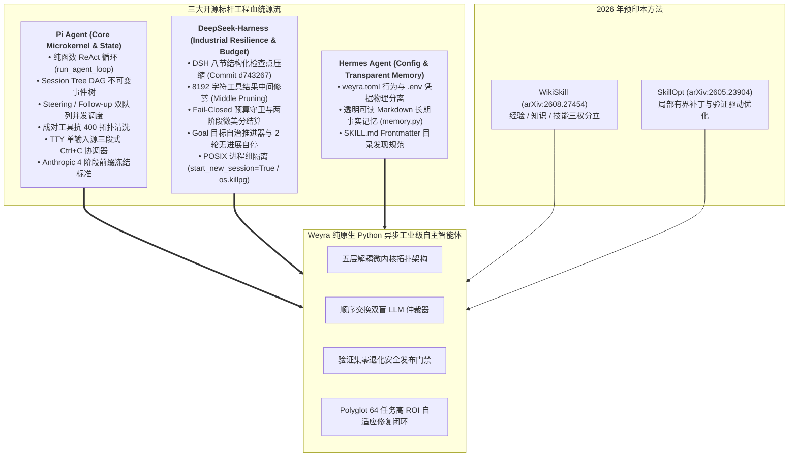
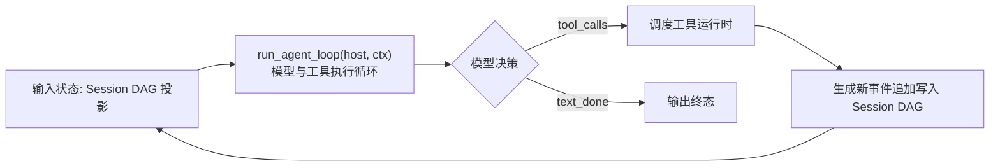
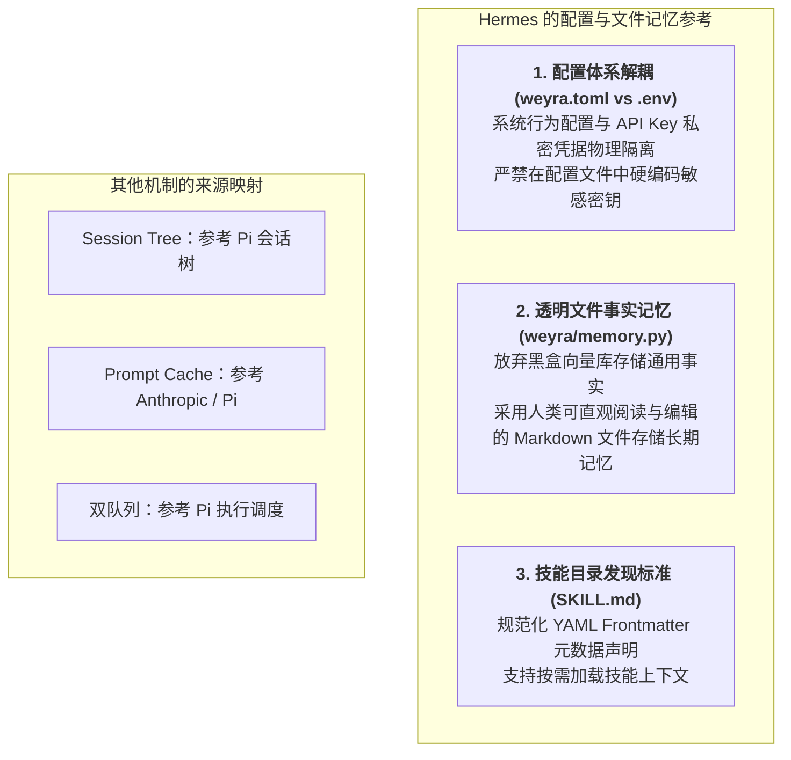
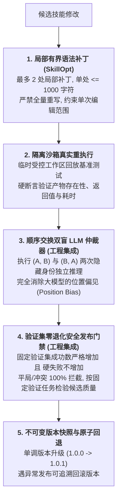

# 开源血统溯源与框架对比全景白皮书 (Pedigree & Architectural Comparison)

> **白皮书定位**：本文档为 **Weyra** 自主编码智能体系统的开源血统溯源、理论映射与工业级架构对比白皮书。
> 系统性剖析 Weyra 如何深度汲取 **Pi Agent**（ReAct 极简纯函数微内核、Session Tree DAG 树状事件溯源、Steering/Follow-up 双队列优先级调度、成对工具抗 400 防御、TTY 单输入源协同）、**DeepSeek-Harness**（DSH 8 节结构化检查点压缩协议、8192 字符中间修剪、Fail-Closed 预算硬防护与微美分结算、POSIX 进程组隔离与多读单写协调锁）以及 **Hermes Agent**（配置与私密凭据分离、透明 Markdown 长期记忆）的精髓，并在原生 Python 异步并发运行时下实现的重大工程超越。

---

## 目录 (Table of Contents)

- [一、 开源血统全景雷达与设计哲学矩阵](#一-开源血统全景雷达与设计哲学矩阵)
- [二、 12 维核心架构多维横向技术对比表](#二-12-维核心架构多维横向技术对比表)
- [三、 Pi Agent 血统深度剖析与微内核映射](#三-pi-agent-血统深度剖析与微内核映射)
- [四、 DeepSeek-Harness 工业级工程规约落地映射](#四-deepseek-harness-工业级工程规约落地映射)
- [五、 Hermes Agent 借鉴边界澄清与配置记忆收敛](#五-hermes-agent-借鉴边界澄清与配置记忆收敛)
- [六、 学术自进化方法 (WikiSkill & SkillOpt) 的工程超越](#六-学术自进化方法-wikiskill--skillopt-的工程超越)
- [七、 总结：融三家之长，铸自主编码智能体新标杆](#七-总结融三家之长铸自主编码智能体新标杆)

---

## 一、 开源血统全景雷达与设计哲学矩阵

Weyra 在系统设计之初，深刻审视了开源界三大标杆项目的架构得失，确立了**“Pi 为魂、DSH 为骨、Hermes 为辅”**的顶层架构指导思想：

---

## 二、 12 维核心架构多维横向技术对比表

以下矩阵按十二个维度对齐参考机制与项目源码实现：

| 架构维度 | 参考机制 | Weyra 的实现 |
| --- | --- | --- |
| **1. 微内核设计** | Pi 执行分层 | 原生 Python asyncio；LoopHost 契约解耦领域与界面 |
| **2. 会话状态** | Pi 会话树 | id / parent / leaf 与 SQLite WAL，保留分支历史 |
| **3. 上下文压缩** | DSH 检查点 | 八节摘要与保留尾部，按容量策略触发 |
| **4. 工具长输出** | Pi 截断 / DSH 中间剪枝 | 8192 Unicode 码点阈值，头4096 / 尾1024，全量原文外置 |
| **5. 缓存组织** | Anthropic / Pi | 最多4个系统与最近消息缓存标记，实际 Usage 计量 |
| **6. 人类干预** | Pi 双队列 | steering 步骤边界接纳，follow-up 整轮后执行 |
| **7. 预算治理** | DSH 预留与结算 | Token / 调用次数 / 可配置人民币上限，Decimal 账本 |
| **8. 工具配对** | Pi / DSH | 按完整交互组切分；恢复未闭合调用 |
| **9. 终端取消** | Pi 交互模式 | TUI 根据执行与草稿状态取消、清空或退出 |
| **10. 并发排他** | DSH 调度 / 会话锁 | 默认10路安全读、写独占；每会话 fcntl 锁 |
| **11. 技能演进** | WikiSkill / SkillOpt | 知识与技能分离、有界文本编辑、重执行与次序交换裁判 |
| **12. 应用接入** | 项目集成 | 统一服务 API、事件订阅、CLI 与 Textual TUI |

---

## 三、 Pi Agent 血统深度剖析与微内核映射

### 3.1 极简纯函数 ReAct 微内核 (`weyra/core/loop.py`)
Pi Agent 最本质的架构贡献在于：**将智能体的生命周期从繁复的框架黑盒中解放出来，回归到纯粹的单步状态转移函数**。
Weyra 严格落地了这一微内核哲学：
- `run_agent_loop` 接收消息流、工具池与上下文策略，在单步中只负责一次纯粹的模型推理与工具决策；
- 循环宿主（`LoopHost`）不依赖任何 Textual UI 或 Web 容器，支持在 CLI、TUI、自动化评测流水线与无头 Daemon 中 复用同一执行契约。

### 3.2 不可变树状 Session Tree DAG (`weyra/session.py`)
Pi Agent 拒绝将对话历史抹平为扁平数组，而是创新性引入了树状拓扑：
- 节点通过 `parent` 显式指向父事件，构成完整的有向无环图（DAG）；
- **时间旅行与无损回溯**：回退历史只需将 `leaf` 指针从节点 $B$ 移向节点 $A$，节点 $B$ 及其子树完整保留在 SQLite 磁盘中；
- 这一机制为 Weyra 实现**非破坏性多方案对比推演（`/branch`）**与**子智能体分叉并行探索（Subagent Forking）**提供了坚不可摧的底层状态基础。

### 3.3 Steering 与 Follow-up 双队列优先级体系
传统智能体在长任务执行期间无法接纳人类新指令。Pi Agent 提出的双队列体系彻底解除了这一束缚：
- **Steering（P0 级即时干预）**：在工具调用的微步骤边界插入，立即阻断原计划并纠正轨迹；
- **Follow-up（P1 级任务排队）**：在整轮任务完全结束后顺序触发，形成长任务自动化流水线。

---

## 四、 DeepSeek-Harness 工业级工程规约落地映射

如果说 Pi Agent 赋予了 Weyra 优雅灵动的灵魂，那么 **DeepSeek-Harness (DSH)** 则赋予了 Weyra 面对残酷生产环境时的钢铁之骨。

### 4.1 DSH 8 节结构化检查点压缩 (Commit `d743267`)
在大模型长程任务中，简单的滑动窗口或泛泛的“请总结上述对话”会导致严重的幻觉与关键技术细节遗失。
Weyra 完整锁定了 DSH 核心仓的 8 节工业级提示词模板（`weyra/core/compaction_prompt.py`）：
1. **Primary Request and Intent**：用户核心意图与演进目标，原样逐字摘录；
2. **Key Technical Concepts**：任务涉及的技术栈、架构模式与工程规范；
3. **Files and Code**：已修改/待修改文件绝对路径清单与核心代码段；
4. **Errors and Fixes**：遇到的错误、修复方案及用户纠正；
5. **Pending Jobs**：用户显式要求但尚未完结的任务清单；
6. **Current Work**：产生当前检查点时刻正在执行的具体操作；
7. **Next Step**：紧接检查点的单一步骤下一步行动建议；
8. **Critical Context**：关键决策理由、限制条件、用户偏好与未决问题。

### 4.2 8192 字符中间修剪（Middle Pruning）与工件外置
工具执行输出经常遭遇极端大文本（如几万行测试日志）：
- Weyra 严格对齐 DSH 规约：超过 8,192 Unicode 码点时，**绝对保留前 4,096 字符（前置环境）与后 1,024 字符（退出状态与错误摘要）**；
- 中间插入形式化标记 `\n\n[... tool result middle pruned ...]\n\n`；
- 全量原始文本落盘至 `.weyra/artifacts/` 目录，并附带磁盘引用标记，**兼顾视窗安全与审计溯源**。

### 4.3 Fail-Closed 预算硬防护体系
- **两阶段预留锁（Two-Phase Reservation）**：调用发出前先扣除保守预估额度，若超限直接拒绝，杜绝“先上车后买票”；
- **真实差额核销（Settlement）**：收到供应商物理返回的 Usage 后多退少补；
- **崩溃自动重放**：进程异常重启后自动扫描挂起凭证全额补扣，杜绝刷单绕过漏洞。

---

## 五、 Hermes Agent 借鉴边界澄清与配置记忆收敛

为了在技术答辩与系统文档中做到学术严谨、绝不张冠李戴，Weyra 明确澄清并收敛了对 **Hermes Agent** 的借鉴边界：

---

## 六、 学术自进化方法 (WikiSkill & SkillOpt) 的工程超越

Weyra 将以下两项研究方法接入本地工具与技能维护链路：
1. **[WikiSkill (arXiv:2608.27454)](https://arxiv.org/abs/2608.27454)**：经验、知识与可执行技能的三权分离架构；
2. **[SkillOpt (arXiv:2605.23904)](https://arxiv.org/abs/2605.23904)**：局部有界语法补丁与验证驱动优化。

并在工程实现上实现了三大重大突破：

---

## 七、 总结：融三家之长，铸自主编码智能体新标杆

| 系统模块 | 核心理论与工程基石 | 核心设计哲学 |
| :--- | :--- | :--- |
| **执行内核** | **Pi Agent** | 极简纯函数状态转移、双队列优先级调度、成对工具抗 400 防御 |
| **持久状态** | **Pi Agent** + **SQLite WAL** | Session Tree DAG 不可变事件树、时间旅行、内核排他锁 |
| **上下文与缓存** | **DeepSeek-Harness** + **Anthropic** | DSH 8 节检查点压缩、8192 字符中间修剪、最多 4 个缓存标记与稳定前缀组织 |
| **资金风控** | **DeepSeek-Harness** | Fail-Closed 两阶段预留锁、事后微美分核销、崩溃重放防刷单 |
| **配置与记忆** | **Hermes Agent** | 行为与私密分离、透明 Markdown 长期记忆、SKILL.md 规范 |
| **自进化系统** | **WikiSkill** + **SkillOpt** | 局部有界补丁、沙箱实测、顺序交换双盲仲裁、验证集零退化门禁 |

Weyra 证明了一条扎实的工程进阶之路：**通过吸纳顶级开源先驱的工业级内核规约，辅以学术界最前沿的自进化理论，在原生 Python 异步生态中打造出一套高内聚、零黑盒依赖、高确定性与高经济效能的工业级自主编码智能体！**

参考源码：[Pi](https://github.com/earendil-works/pi/tree/4270522473e677ddba7b093caa0064a3df51d459)、[dg-ai-notes](https://github.com/buchidonggua/dg-ai-notes)、[DeepSeek Harness](https://github.com/deepseek-ai/deepseek-harness/tree/d743267388641bc76f17c45ce8b4c231aed1d32c)、[Hermes](https://github.com/NousResearch/hermes-agent/tree/590af66a58c2b3eb3c5edd1dcfefa09c625ae18a)。
