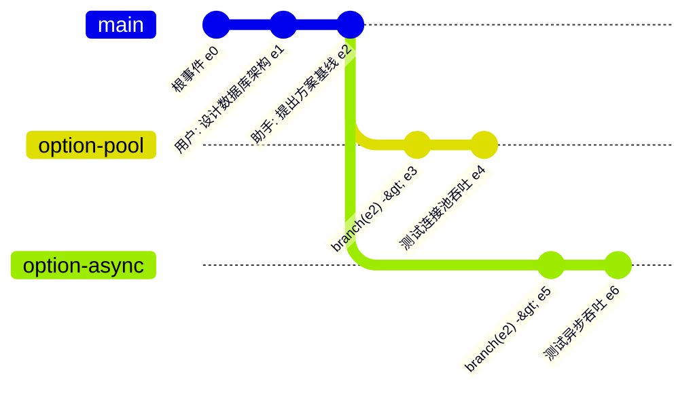
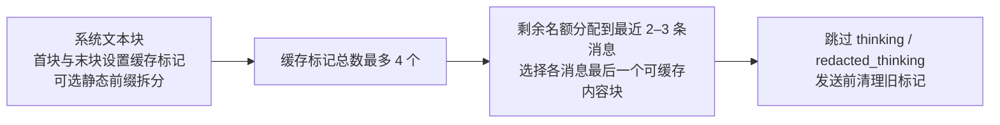
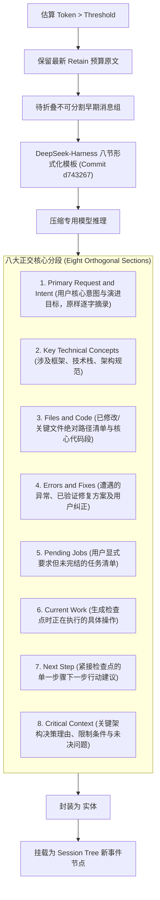
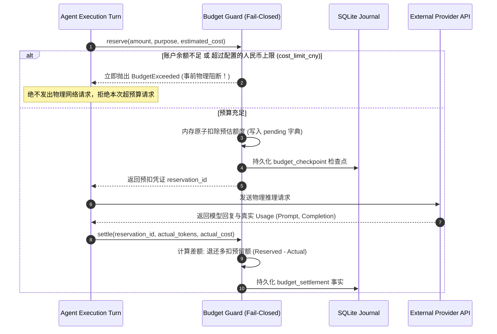
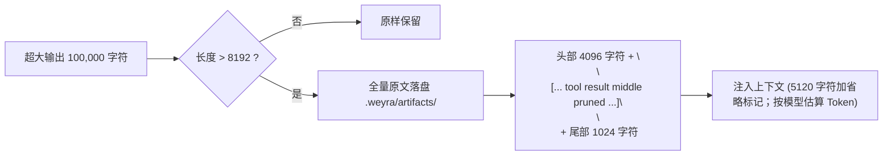
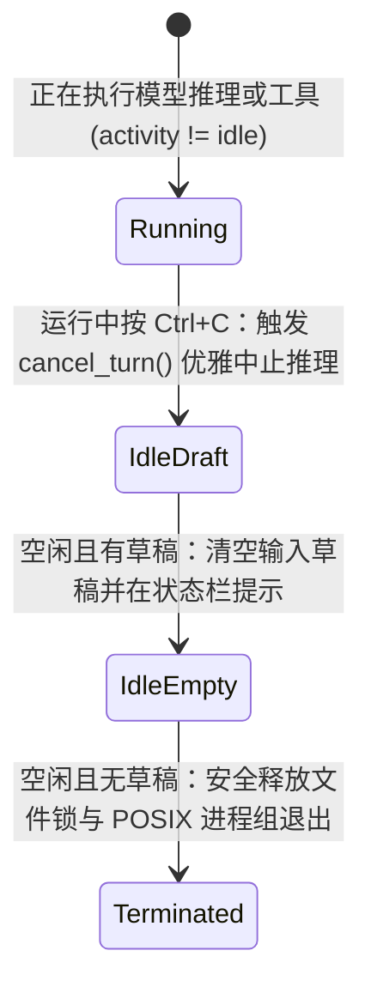
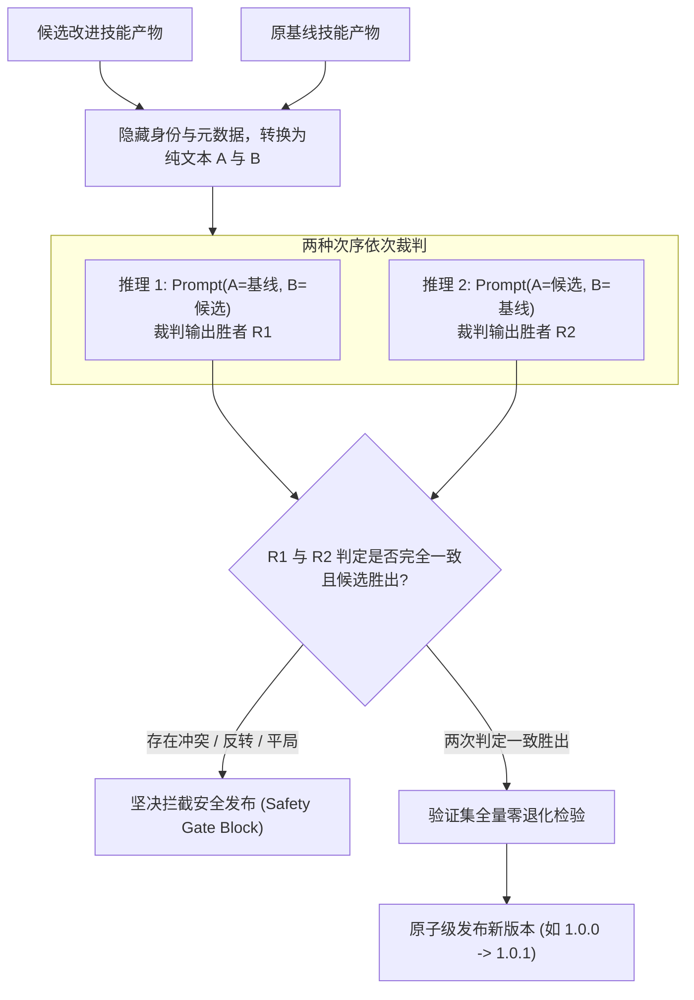
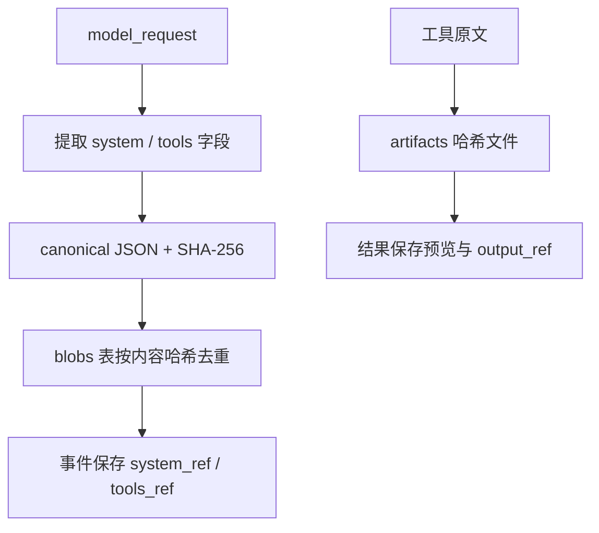
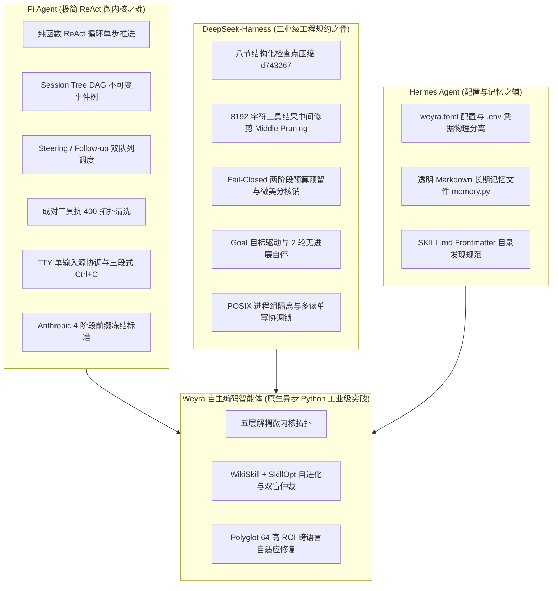

# Weyra 架构深度演进与高频技术答辩指南 (Architecture Deep Dive & Interview Defense Guide)

> **文档定位**：本文档为 **Weyra** 自主编码智能体系统的官方核心技术答辩与深度架构解剖指南。
> 面向资深技术专家、架构评审委员会与顶级大厂面试官，针对智能体系统在**长程状态一致性、高频并发、上下文衰减、大模型幻觉、资金穿透、终端交互与学术理论落地**等维度的 15 大最具挑战性的底层硬核问题，提供公式推导、状态机流转图、源码级实现机理与实测数据支撑。

---

## 目录 (Table of Contents)

- [Q01: 哲学与选型：为什么坚决放弃 LangChain / LlamaIndex 重型框架，自研纯原生微内核？](#q01-哲学与选型为什么坚决放弃-langchain--llamaindex-重型框架自研纯原生微内核)
- [Q02: 状态架构：为什么采用 Pi Agent 的 Session Tree DAG，而不是传统线性历史数组？](#q02-状态架构为什么采用-pi-agent-的-session-tree-dag而不是传统线性历史数组)
- [Q03: 缓存命脉：为什么说 Prompt Cache 是多轮智能体的生命线？Weyra 如何组织缓存并核验收益？](#q03-缓存命脉为什么说-prompt-cache-是多轮智能体的生命线weyra-如何组织缓存并核验收益)
- [Q04: 长程记忆：详细推导 DeepSeek-Harness 八节结构化压缩算法与动态容量方程？](#q04-长程记忆详细推导-deepseek-harness-八节结构化压缩算法与动态容量方程)
- [Q05: 资金防线：什么是 Fail-Closed 预算守卫？两阶段预留锁如何根除资金穿透？](#q05-资金防线什么是-fail-closed-预算守卫两阶段预留锁如何根除资金穿透)
- [Q06: 意图调度：Pi 风格双队列（Steering vs Follow-up）解决了长程任务中的什么本质矛盾？](#q06-意图调度pi-风格双队列steering-vs-follow-up解决了长程任务中的什么本质矛盾)
- [Q07: 协议抗脆弱：为什么工具调用频繁遭遇 HTTP 400 Bad Request？成对工具拓扑如何自愈？](#q07-协议抗脆弱为什么工具调用频繁遭遇-http-400-bad-request成对工具拓扑如何自愈)
- [Q08: 大文本修剪：为什么选择 8192 字符中间修剪（Middle Pruning），而不是头部或尾部截断？](#q08-大文本修剪为什么选择-8192-字符中间修剪middle-pruning而不是头部或尾部截断)
- [Q09: 终端打断：三段式 Ctrl+C 终端协同机制的底层状态机与 POSIX 信号治理原理？](#q09-终端打断三段式-ctrlc-终端协同机制的底层状态机与-posix-信号治理原理)
- [Q10: 学术超越：自进化技能系统如何通过“顺序交换双盲 LLM 仲裁”消除位置偏见？](#q10-学术超越自进化技能系统如何通过顺序交换双盲-llm-仲裁消除位置偏见)
- [Q11: 高效修复：Polyglot 64 基准中为什么单题成本仅 ¥0.77？小模型达 78.1% 通过率的核心突破？](#q11-高效修复polyglot-64-基准中为什么单题成本仅-077小模型达-781-通过率的核心突破)
- [Q12: 安全防线：意图路由中 8 次歧义测试执行达成 100% 安全弃权的技术机理与工程价值？](#q12-安全防线意图路由中-8-次歧义测试执行达成-100-安全弃权的技术机理与工程价值)
- [Q13: 并发安全：多进程同时打开同一会话时，底层如何杜绝脑裂与数据损坏？](#q13-并发安全多进程同时打开同一会话时底层如何杜绝脑裂与数据损坏)
- [Q14: 存储扩展：面对大日志大文件，SQLite B-Tree 如何避免碎片化与性能劣化？](#q14-存储扩展面对大日志大文件sqlite-b-tree-如何避免碎片化与性能劣化)
- [Q15: 血统归位：如何清晰界定 Pi Agent、DeepSeek-Harness 与 Hermes 在 Weyra 中的架构边界？](#q15-血统归位如何清晰界定-pi-agentdeepseek-harness-与-hermes-在-weyra-中的架构边界)

---

### Q01: 哲学与选型：为什么坚决放弃 LangChain / LlamaIndex 重型框架，自研纯原生微内核？

**答辩要点**：
Weyra 的目标是让模型调用、上下文和工具副作用保持可检查，因此采用直接的 Python asyncio 分层：
1. `llm` 统一协议，`core` 组织模型与工具步骤，`coding` 装配领域能力。
2. 稳定提示词基线与动态事实分开，工具声明确定排序，便于检查请求前缀与 Usage。
3. 会话树、预算预留和作业生命周期通过显式契约连接，故障时可以沿事件与账本定位。

这一选型服务于本地可读、可改造的 harness；源码入口见 `core/loop.py` 和 `coding/agent.py`。

---

### Q02: 状态架构：为什么采用 Pi Agent 的 Session Tree DAG，而不是传统线性历史数组？

**答辩要点**：
传统线性消息数组（`messages: list[Message]`）具有三大致命缺陷：
- **无法支持非破坏性平行推演**：如果用户想对比“异步方案”与“连接池方案”，需要另外保存会话分支，才能同时保留多条探索路径；
- **回滚成本高昂**：回退某一步骤需要原地截断数组，一旦后悔无法再次向前重做；
- **难以支持 Subagent 分叉与合并**：子智能体并行探索时无法直接复用前序只读历史。



**Weyra 的底层落地**：
在 `weyra/session.py` 中落地了 **Pi Agent Session Tree DAG（树状有向无环图）**：
- 每一条事件记录持有 `id` 与 `parent`；
- **零拷贝分支创建（Zero-Copy Branching）**：调用 `branch(parent)` 仅仅是将活动指针 `self.leaf` 重定向至指定节点，指针移动与追加事件不复制旧历史；完整分支校验仍遍历祖先投影；
- **派生会话（Forking）**：调用 `fork()` 时自动提取当前分支祖先链路作为消息投影（`seed`），创建拥有独立 ID 的会话；子 Agent 仍共享项目与父级预算。

---

### Q03: 缓存命脉：为什么说 Prompt Cache 是多轮智能体的生命线？Weyra 如何组织缓存并核验收益？

**答辩要点**：
在长程自主编码任务中，单次交互的上下文往往高达 30,000 ~ 100,000 tokens。若每次交互都要大模型从第 0 个 token 开始重新计算注意力矩阵（Prefill 阶段），将导致：
1. **首字延迟**：未缓存输入需要重新执行 Prefill，耗时随模型、端点与输入量变化；
2. **算力成本倍增**：缓存与未缓存输入按端点费率分别计价。

**Weyra 的 4 阶段前缀冻结机制 (`weyra/llm/providers.py`)**：
严格对齐 Anthropic 4 断点规范与 vLLM/SGLang 块级前缀匹配机理：



- **严苛不变性**：
  1. 系统提示词严禁包含当前动态时间戳或随请求变化的随机数；
  2. 工具 Schema 声明顺序字典序锁定；
  3. 历史消息只允许在尾部单调追加，严禁跨轮次中间篡改。
- **核验方法**：从服务端 Usage 计算缓存读 Token 占比，使用逐请求计时统计 TTFT，并按配置的缓存与未缓存费率计算金额。固定命中率或延迟需要对应运行记录支撑。

---

### Q04: 长程记忆：详细推导 DeepSeek-Harness 八节结构化压缩算法与动态容量方程？

**答辩要点**：
当长程任务上下文逼近视窗物理极限时，暴力丢弃前文会导致模型遗忘已修改的文件或反复犯同样的错误。

**Weyra 的 DSH 动态容量数学模型 (`weyra/core/context.py`)**：
设物理窗口为 $C$，预留输出为 $R$，安全余量为 $H$（默认 65,536），触发水位比例 $\theta = 0.8$，保留最新窗口比例 $\rho = 0.16$：

$$\text{可用压力上限 } P = C - R - H$$
$$\text{触发压缩阈值 } \text{Threshold} = \left\lfloor \min(C \times \theta, \; P) \right\rfloor$$
$$\text{保留尾部原文预算 } \text{Retain} = \left\lfloor (C - R) \times \rho \right\rfloor$$
$$\text{系统核心约束 } \text{Retain} < \text{Threshold} \quad \text{且} \quad P > 0$$



通过这八大正交维度，模型在后续轮次中就像查阅“工业级交接班日志”，**将关键事实组织成可继续执行的交接记录**。

---

### Q05: 资金防线：什么是 Fail-Closed 预算守卫？两阶段预留锁如何根除资金穿透？

**答辩要点**：
传统智能体通常在调用大模型返回后再扣费（Fail-Open 后计费模式）。一旦模型陷入递归死循环或高并发子任务并发派生，往往在几十秒内产生数千元巨额开销，造成灾难性资损。

**Weyra 的 Fail-Closed 两阶段预留锁机制 (`weyra/core/state.py`)**：



- **崩溃防刷单特性**：如果进程在物理请求发出后意外断电崩溃，重启后 `attach()` 函数自动扫描未被 `settle` 的 `pending` 预扣额，**全额重放计入总账**，彻底封堵通过“制造网络崩溃刷免费调用”的黑客漏洞。
- **验证入口**：预算预留、并发与恢复由 `test_budget_cost.py`、`test_delivery_boundaries.py` 等回归用例验证。

---

### Q06: 意图调度：Pi 风格双队列（Steering vs Follow-up）解决了长程任务中的什么本质矛盾？

**答辩要点**：
在长程自主编码任务中，人类存在两类截然不同的干预诉求：
1. **即时打断（Steering）**：“停！不要改 A 模块，去改 B 模块！”——必须在当前工具执行步结束后立刻生效；
2. **异步排队（Follow-up）**：“改完这个函数后，把单元测试也跑一下”——必须等当前整轮任务完全结束后按顺序执行。

若没有双队列，单输入源会导致用户必须死等长任务结束，或者暴力 `kill` 进程破坏中间状态。

**Weyra 的双队列并发调度架构 (`weyra/coding/agent.py`)**：
```python
self._queues = {"steering": [], "follow_up": []}
```
- **Steering 队列**：优先级最高，在 `LoopHost` 单步执行边界处被优先拉取并消费；
- **Follow-up 队列**：在当前 ReAct 轮次触发终态时，自动拉取队首任务开启全新轮次；
- **持久化一致性**：所有排队动作均持久化为 `input_queued`，消费后写入 `input_consumed`，进程异常重启时自动无损恢复双队列状态。

---

### Q07: 协议抗脆弱：为什么工具调用频繁遭遇 HTTP 400 Bad Request？成对工具拓扑如何自愈？

**答辩要点**：
OpenAI、Anthropic、DeepSeek 等大模型标准协议规定：**如果 Assistant 消息包含了 `tool_calls`（如调用了 2 个工具），后续消息流中必须且只能紧随 2 条完全匹配 `tool_call_id` 的 Tool Result 消息**。

**400 错误的产生根因**：
- 在滑动窗口裁剪时，截断边界恰好落在了 Assistant 工具调用与 Tool 结果之间；
- 工具执行时抛出未捕获的 Python 致命异常，导致结果消息未能成功写入消息序列；
- 后续请求将残缺的孤立 Tool 或未闭合的 Assistant 消息发给云端，云端直接拒绝服务（`400 Bad Request: An assistant message with tool calls must be followed by tool messages`）。

**Weyra 的不可分割原子组（Interaction Group）防护算法 (`weyra/core/context.py`)**：
```python
from weyra.core.context import complete_groups

# complete_groups(messages) 按闭合工具交互组生成切分边界
```
当系统在启动校验中发现历史数据存在孤立未闭合的调用时，底层自动触发**拓扑自愈机制**，合成本地错误占位回执将其严格闭合，**从源头根除了长程调用中的 400 崩溃**。

---

### Q08: 大文本修剪：为什么选择 8192 字符中间修剪（Middle Pruning），而不是头部或尾部截断？

**答辩要点**：
当工具执行 `git log`、`pytest` 或大文件扫描时，可能产生 100,000+ 字符的超大输出：
- **纯头部截断（Truncate Tail）**：保留前 5,000 字符，但丢失了控制台最关键的尾部测试总结、退出状态码与失败断言行号；
- **纯尾部截断（Truncate Head）**：保留后 5,000 字符，但丢失了命令启动参数、前置路径与执行上下文。

**Weyra 严格落地的 DeepSeek-Harness 8192 字符中间修剪规约 (`weyra/output.py`)**：

- 保留头部 4,096 字符：确保命令启动、参数与环境上下文完整；
- 保留尾部 1,024 字符：确保退出状态码与最终错误摘要清晰可见；
- 显式修剪标记明确告知大模型中间因冗长已被截除，杜绝模型幻觉；全量原文完整落盘，可供后续 `read_file(offset=...)` 深入查阅。

---

### Q09: 终端打断：三段式 Ctrl+C 终端协同机制的底层状态机与 POSIX 信号治理原理？

**答辩要点**：
在桌面端或 CLI 中，用户按 `Ctrl+C` 的心理预期是分层次的：
- 第一次按：通常是想“中断当前正在发散推理的模型”；
- 第二次按：通常是想“清空刚在输入框敲错的草稿”；
- 第三次按：才是真正想要“退出整个终端应用”。

如果粗暴地在捕获 `SIGINT` 时直接调用 `sys.exit(0)`，会导致当前正在写入 SQLite 的事务损坏、后台 Shell 衍生出孤儿僵尸进程。

**Weyra 的三段式渐进退避状态机 (`weyra/tui/app.py`)**：

- **POSIX 进程组隔离**：所有后台 Shell 命令通过 `start_new_session=True` 创建独立进程组；退出或超时取消时，系统调用 `os.killpg(pgid, signal.SIGTERM)`，彻底清空全部派生的孙子子进程，**清理本任务拥有的进程组**。

---

### Q10: 学术超越：自进化技能系统如何通过“顺序交换双盲 LLM 仲裁”消除位置偏见？

**答辩要点**：
**SkillOpt (arXiv:2605.23904, 2026)** 提出有界文本优化与验证分数严格改善的接受原则。Weyra 在本地技能任务中组合真实重执行和次序交换匿名比较。
然而认知科学与 NLP 实验证明，大模型具有极其严重的**位置偏好偏见（Position Bias）**——倾向于认定排在前面的选项 A 更好（或在某些提示词下偏好选项 B）。

**Weyra 工程集成：顺序交换双盲 LLM 仲裁器 (`weyra/skill_judge.py`)**：



通过严格的 $(A, B)$ 与 $(B, A)$ 两次独立双盲推理，**对次序冲突结果实施弃权**，配合验证集零退化硬门禁，让固定验证任务上的发布决定具有检查依据。

---

### Q11: 高效修复：Polyglot 64 基准中为什么单题成本仅 ¥0.77？小模型达 78.1% 通过率的核心突破？

**答辩要点**：
在 Polyglot 64 任务中，Weyra 达成了 **78.125% 的综合修复通过率（Python 87.5%）**，而累计保守费率估算约 **¥49.49（单题仅 ¥0.77）**。

**对应的工程条件**：
1. 主路由使用端点标识 `DeepSeek-V4.1-Flash`，同时配置 `gpt-5.6-luna` 备用路由。
2. 主请求上限为 4096 token，摘要为 2048 或扩展后的 4096；按任务预算约束迭代。
3. 累计保留 29 题通过结果，35 题继续运行后新增通过 21 题，挽救率为 60.0%；不是全部在第二轮完成。
4. ¥49.49 是多个阶段累计的保守费率估算，除以 64 为每题约 ¥0.77。具体任务与协议见[公开证据](evidence/README.md)。

---

### Q12: 安全防线：意图路由中 8 次歧义测试执行达成 100% 安全弃权的技术机理与工程价值？

**答辩要点**：
传统智能体在面对“帮我清理一下系统”或“加速一下代码”等输入时，往往盲目揣测用户意图，直接调用破坏性 Shell 工具或乱改配置文件。

**Weyra 的技能弃权机制**：
技能定位根据词法候选、显式技能 ID 与实际使用快照选择目标；不明确匹配时允许不选择技能。该实现不依赖语义向量阈值。

固定评测中，歧义/无匹配任务的 8 次执行正确弃权 8/8，基线为 0/8。它衡量技能选择；工具授权由独立权限与审批机制处理。

---

### Q13: 并发安全：多进程同时打开同一会话时，底层如何杜绝脑裂与数据损坏？

**答辩要点**：
在复杂工程流水线中，可能存在多个 CLI、TUI 窗口或后台批处理脚本同时指定同一个会话 ID 试图写入。

**Weyra 的三级防御体系 (`weyra/session.py`)**：
1. **POSIX 内核级非阻塞排他锁 (`fcntl.flock`)**：
   每个会话对应 `.weyra/locks/<sha256(session_id)>.lock` 文件。在打开会话时，系统以 `fcntl.flock(LOCK_EX | LOCK_NB)` 申请锁。若该会话已由另一进程打开，操作系统内核直接拒绝并抛出 `SessionError("Session locked by another writer")`，从源头杜绝并发双写；
2. **SQLite WAL 事务强隔离**：
   开启 `PRAGMA synchronous=FULL` 与 `PRAGMA foreign_keys=ON`，所有更新包含在 `BEGIN IMMEDIATE` 独占事务中；
3. **内存可重入锁 (`threading.RLock`)**：
   保护单进程内多线程并发操作，确保事件追加、指针推进与快照导出的原子性。

---

### Q14: 存储扩展：面对大日志大文件，SQLite B-Tree 如何避免碎片化与性能劣化？

**答辩要点**：
如果将包含数十万字符的文件内容或日志直接内联存储在 SQLite 的 `events` 表中，会导致 SQLite B-Tree 的内部节点发生严重的页溢出（Page Overflow），使得数据库体积快速膨胀且查询性能暴跌。

**Weyra 的 CAS 大对象解耦存储引擎 (`weyra/session.py`)**：


大对象按字段与结果类型管理，不使用统一 1024 字节内联阈值。相同哈希内容可以复用，模型输入使用投影与预览，完整证据保存在相应存储中。

---

### Q15: 血统归位：如何清晰界定 Pi Agent、DeepSeek-Harness 与 Hermes 在 Weyra 中的架构边界？

**答辩要点**：
在技术答辩与代码审查中，必须如实、清晰地界定各大开源标杆在 Weyra 中的真实血统边界，坚决杜绝张冠李戴：



**终极边界结论**：
- **Pi Agent** 是 Weyra 的微内核交互哲学与状态溯源之魂；
- **DeepSeek-Harness** 是 Weyra 的长文本治理、预算硬防护与工业级工程规范之骨；
- **Hermes Agent** 是配置规范与透明文件记忆之辅；
- **Weyra 本身** 则是深度融合顶会前沿学术自进化体系、以纯原生 Python 异步并发交付的下一代高确定性自主编码智能体基础设施。
