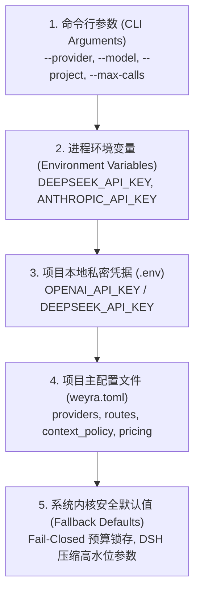
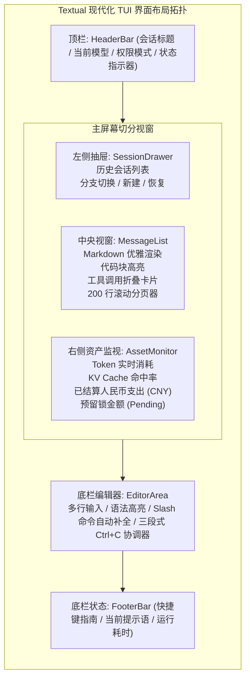
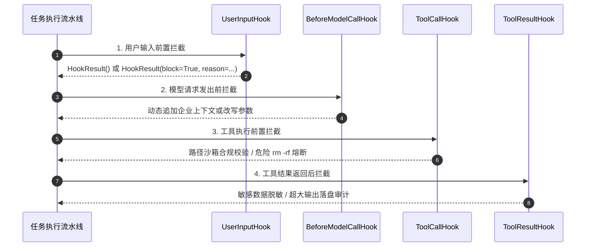
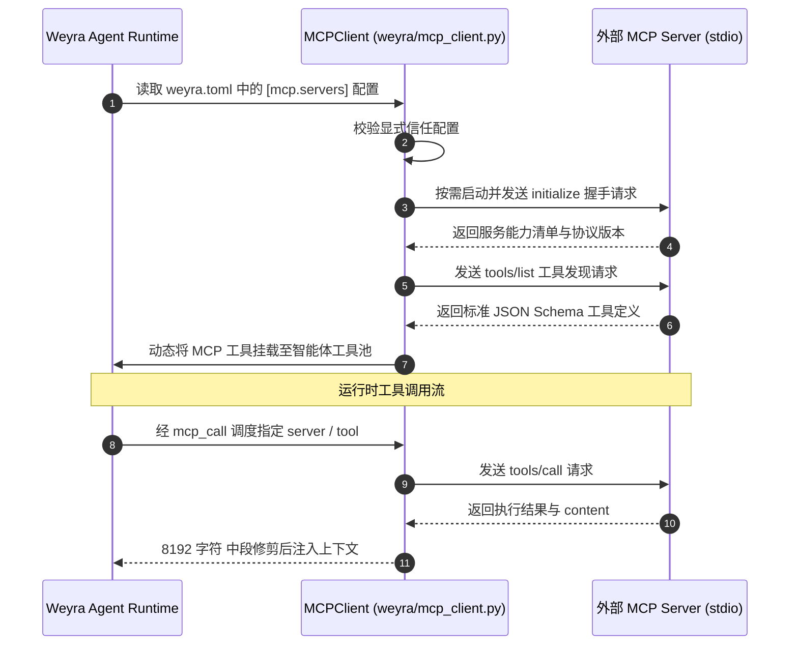

# Weyra 开发者全功能实战与企业级运维指南 (Developer & Operations Guide)

> **全景指南**：系统环境就绪、双模终端（流式 CLI & Textual TUI）、5 级配置规范、交互控制指令集、Python SDK 编程式开发、5 大 Hook 插件管道、MCP 标准网桥以及生产级容器化部署。
>
> 适用于全栈开发者、DevOps 运维工程师与系统集成专家的完整实战手册。

---

## 目录 (Table of Contents)

- [一、 快速安装与环境就绪](#一-快速安装与环境就绪)
- [二、 5 级配置覆盖体系与生产模板](#二-5-级配置覆盖体系与生产模板)
- [三、 双模终端交互实战 (流式 CLI & Textual TUI)](#三-双模终端交互实战-流式-cli--textual-tui)
- [四、 Python SDK 编程式接入与生命周期管理](#四-python-sdk-编程式接入与生命周期管理)
- [五、 5 大全生命周期 Hook 插件体系实战](#五-5-大全生命周期-hook-插件体系实战)
- [六、 Model Context Protocol (MCP) 原生网桥集成](#六-model-context-protocol-mcp-原生网桥集成)
- [七、 生产级容器化部署与系统守护治理](#七-生产级容器化部署与系统守护治理)
- [八、 常见错误诊断与故障排查速查表](#八-常见错误诊断与故障排查速查表)

---

## 一、 快速安装与环境就绪

### 1.1 系统要求
- **Python 版本**：Python 3.11 及以上（充分发挥 `asyncio` 现代特性、类型注解与轻量内存优势）；
- **操作系统支持**：
  - macOS (Apple Silicon M 系列 & Intel x86_64)；
  - Linux (Ubuntu 20.04+, Debian 11+, CentOS/RHEL 8+)；
  - Windows (强烈推荐通过 **WSL2** 运行，充分依托 POSIX `fcntl` 文件锁与进程组隔离机制)；
- **环境隔离**：强烈建议在独立的虚拟环境（`venv` 或 `conda`）中运行。

### 1.2 极速安装与开发环境搭建
```bash
# 1. 克隆代码仓库
git clone https://github.com/weyra-ai/weyra.git
cd weyra

# 2. 创建并激活 Python 3.11+ 虚拟环境
python3 -m venv .venv
source .venv/bin/activate  # macOS / Linux
# .venv\Scripts\activate   # Windows

# 3. 安装全功能开发与 TUI 依赖 (以可编辑模式安装)
python -m pip install --upgrade pip
python -m pip install -e '.[dev,tui]'

# 4. 验证核心自动化测试套件
pytest tests/test_service.py tests/test_layout.py tests/test_config_runtime_completion.py tests/test_evaluation.py -q
# 当前版本: 38 passed；具体耗时以本机输出为准
```

### 1.3 极速离线体验 (零 API Key 成本即刻验证)
Weyra 内置了完备的确定性沙箱仿真运行环境，无需配置任何外部模型 API Key 即可全链路验证工具调用、上下文推进与状态机流转：

```bash
# 1. 运行项目深度架构分析离线演示
weyra demo --scenario analysis --offline --project /tmp/weyra-demo-analysis

# 2. 运行专业长文档写作与自进化离线演示
weyra demo --scenario writing --offline --project /tmp/weyra-demo-writing

# 3. 运行全链路系统效能离线评估
weyra eval --offline --project /tmp/weyra-eval
```

---

## 二、 5 级配置覆盖体系与生产模板

Weyra 拥有严密的工业级配置系统，支持从单次命令临时调试到企业级生产部署的灵活适配。配置项严格遵循以下 **5 级优先级从高到低** 依次生效：



### 2.1 典型生产配置全景 (`weyra.toml`)
复制项目根目录的 `weyra.example.toml` 为 `weyra.toml`，即可根据业务场景定制提供商与路由：

```toml
# ==========================================
# 1. 模型提供商端点配置 (Providers)
# ==========================================
[providers.deepseek]
protocol = "openai"
api_key_env = "DEEPSEEK_API_KEY"
base_url = "https://api.deepseek.com"

[providers.anthropic]
protocol = "anthropic"
api_key_env = "ANTHROPIC_API_KEY"

# ==========================================
# 2. 动态用途路由配置 (Purpose Routes)
# ==========================================
# 主任务执行路由 (高性价比主力模型)
[routes.main]
provider = "deepseek"
model = "deepseek-chat"
context_window = 131072
max_output_tokens = 8192

# 压缩专用辅助路由 (挂载极速模型)
[routes.compression]
provider = "deepseek"
model = "deepseek-chat"
context_window = 131072
max_output_tokens = 8192

# 技能自进化独立双盲裁判路由
[routes.skill_judge]
provider = "deepseek"
model = "deepseek-chat"
context_window = 131072
max_output_tokens = 2048

# ==========================================
# 3. 上下文与压缩策略 (Context Policy)
# ==========================================
[context_policy]
# 严格对齐 DeepSeek-Harness 工业级压缩方程
threshold_ratio = 0.8
headroom_tokens = 65536
retain_ratio = 0.16
max_tokens = 8192
compaction_retries = 1
summary_mode = "dsh_checkpoint"

# 自动技能演进默认关闭；开启前需要独立裁判与固定验证集。
[skill_evolution]
enabled = false
```

### 2.2 配置合规性快速检查工具
在不消耗任何外部 API Token 的前提下，一键验证配置文件的语法、凭据就绪与路由参数合规性（不测试端点连通性）：
```bash
weyra check-config --project .
```

---

## 三、 双模终端交互实战 (流式 CLI & Textual TUI)

### 3.1 原生流式 CLI
专为追求极速响应、管道重定向与 CI/CD 自动化流水线打造：

```bash
# 1. 启动交互式 CLI 会话
weyra --project .

# 2. 下发单次长程任务 (执行完毕后安全退出)
weyra "重构本项目的数据访问层，引入连接池并增加并发测试" --project .

# 3. 限制当前交互的 Token 与调用次数
weyra --project . --max-tokens 200000 --max-calls 50

# 4. 恢复指定历史会话断点继续执行
weyra --resume 0192a6c8-1234-7000-8000-000000000001 --project .
```

### 3.2 Textual 卡片化现代化 TUI
专为需要可视化监控多轮会话树、实时模型思考过程、工具折叠卡片与资产资金流动的开发者设计：

```bash
weyra --project . --ui tui
```



### 3.3 交互控制指令集 (Slash Commands) 全量参考表

在 CLI 或 TUI 终端中，可随时键入以下斜杠指令：

| 指令 | 入参示例 | 核心功能与安全保障 |
| :--- | :--- | :--- |
| **`/cost`** | 无 | 查看当前会话精确已发生费用、缓存命中 Token 数与预留金额。采用微美分高精度呈现。 |
| **`/plan`** | `on` 或 `off` | 切换安全只读计划模式。开启后允许只读分析与专用计划文件修改，禁止 Shell。 |
| **`/compact`** | 无 | 手动触发 DeepSeek-Harness 8 节结构化检查点提炼，提前释放模型视窗空间。 |
| **`/clear`** | 无 | 安全重置模型上下文视窗。底层 SQLite 事实、历史分支与资金账本绝对不删除。 |
| **`/branch`** | `[event_id]` | 在当前会话中从指定历史事件创建平行分支，秒级切换活动叶子指针。 |
| **`/fork`** | `[session_name]` | 派生出全新的独立会话，历史作为种子事件拷贝，独立 ID 与上下文；CodingAgent 子任务共享父级预算。 |
| **`/steer`** | `<instruction>` | 向 Pi 风格 Steering 即时干预队列插入指令，在当前工具执行步结束后立即强制转向。 |
| **`/followup`** | `<instruction>` | 向 Pi 风格 Follow-up 队列追加任务，待当前整轮执行彻底完成后自动排队执行。 |
| **`/skills`** | 无 | 打开自进化技能管理器，查看已安装技能及其当前单调版本号。 |
| **`/skill-rollback`** | `<name> <v>` | 将指定技能安全回滚至历史版本，毫秒级原子切换，杜绝停机风险。 |
| **`/help`** | 无 | 弹出终端快捷键与完整指令帮助面板。 |

---

## 四、 Python SDK 编程式接入与生命周期管理

对于需要将 Weyra 嵌入企业私有系统、自动化研发流水线或多 Agent 协同网络的开发者，Weyra 提供了极简且强大的 Python 异步 SDK。

### 4.1 编程式单任务执行实战

示例启用人民币上限，需要在 `pricing` 中填写所用端点费率；无需密钥的完整接口示例见 [sdk_service.py](../examples/sdk_service.py)。
```python
import asyncio
from pathlib import Path
from weyra.service import WeyraAppService

async def main():
    service = WeyraAppService(Path.cwd(), budget_limit_cost_cny="20.00")
    await service.start()
    _, subscription = await service.subscribe("example")
    try:
        receipt = await service.submit("阅读本仓库并总结架构", client_request_id="summary-1")
        if not receipt.accepted:
            raise RuntimeError(receipt.message)
        while True:
            event = await subscription.get()
            if event is None:
                raise RuntimeError("订阅结束，请检查服务状态")
            if event.kind == "text_delta":
                print(event.data["delta"], end="", flush=True)
            elif event.kind == "service_error":
                raise RuntimeError(event.data["message"])
            elif event.kind == "turn_end":
                print("\n轮次状态:", event.data["state"])
                break
        snapshot = await service.get_snapshot()
        print("预算账本:", snapshot.budget)
    finally:
        service.unsubscribe("example")
        await service.close()

if __name__ == "__main__":
    asyncio.run(main())
```

---

## 五、 5 大全生命周期 Hook 插件体系实战

Weyra 在 `weyra/core/hooks.py` 中构建了解耦的 Hook 事件总线，允许开发者在不侵入核心引擎代码的前提下，非侵入式地注入鉴权、敏感信息脱敏、审计阻断与动态改写逻辑：



### 5.1 编写自定义安全守卫 Hook 示例
```python
from weyra.core.hooks import (
    UserInputHook,
    ToolCallHook,
    HookResult,
)

# 1. 用户输入前置安全审查 Hook
def custom_input_auditor(payload):
    user_text = payload.input_text
    if "DROP DATABASE" in user_text or "DROP TABLE" in user_text:
        return HookResult(block=True, reason="请求需要人工复核")
    return HookResult()

# 2. 工具调用前置沙箱防护 Hook
def protect_tool_execution(payload):
    tool_name = payload.tool_name
    tool_args = payload.args
    if tool_name == "run_shell":
        cmd = tool_args.get("command", "")
        if "rm -rf /" in cmd or ":(){ :|:& };:" in cmd:
            return HookResult(block=True, reason="命令需要人工复核")
    return HookResult()

# 3. 注册至 CodingAgent 实例 agent（不是 service.hooks）
agent.hooks.register(UserInputHook, custom_input_auditor)
agent.hooks.register(ToolCallHook, protect_tool_execution)
```

---

## 六、 Model Context Protocol (MCP) 原生网桥集成

Weyra 原生支持业界标准的 **Model Context Protocol (MCP)**，支持通过标准 stdio 管道连接任何外部生态工具池（如 GitHub、PostgreSQL、Slack、Docker 等）：



### 6.1 在 `weyra.toml` 中配置 MCP 服务器
```toml
# GitHub MCP stdio 服务器配置示例；安装命令按所选实现核对
[mcp.servers.github]
command = "npx"
args = ["-y", "@modelcontextprotocol/server-github"]
env = { GITHUB_PERSONAL_ACCESS_TOKEN = "GITHUB_PERSONAL_ACCESS_TOKEN" }

# 挂载 PostgreSQL 数据库只读 MCP 服务器
[mcp.servers.postgres]
command = "uvx"
args = ["mcp-server-postgres", "--connection-string", "postgresql://readonly@localhost:5432/mydb"]
```
先通过 `/mcp-trust github` 等指令显式信任服务器配置，再按需启动并发现工具。MCP 工具调用受权限治理；外部服务器自行产生的服务费用不属于 Weyra 的模型 Token 账本。

---

## 七、 生产级容器化部署与系统守护治理

### 7.1 Docker 容器化最佳实践
针对多租户或隔离环境，推荐基于 Docker 运行 Weyra：

```dockerfile
# 生产级极简 Dockerfile
FROM python:3.11-slim

WORKDIR /app

# 安装基础依赖与构建工具
RUN apt-get update && apt-get install -y --no-install-recommends \
    git \
    curl \
    build-essential \
    && rm -rf /var/lib/apt/lists/*

# 复制项目代码并安装
COPY . /app
RUN pip install --no-cache-dir -e '.[dev,tui]'

# 声明项目状态挂载卷
VOLUME ["/project"]

WORKDIR /project

ENTRYPOINT ["weyra"]
CMD ["--project", "/project"]
```

构建并运行容器：
```bash
docker build -t weyra-agent:latest .

# 启动容器并挂载宿主机项目代码目录
docker run -it --rm \
    -v $(pwd):/project \
    -e DEEPSEEK_API_KEY \
    weyra-agent:latest --ui tui
```

---

## 八、 常见错误诊断与故障排查速查表

| 错误表现 / 异常类型 | 根本原因剖析 (Root Cause) | 工业级解决方案与恢复策略 |
| :--- | :--- | :--- |
| **`SessionError: Session locked by another writer`** | 另一个终端或进程正在占用该会话的 `.lock` 文件，`fcntl.flock` 独占加锁失败。 | 确认无正在运行的后台任务。若因宕机残留，检查对应进程 ID 是否存活，正常关闭持锁进程后重试；不要在仍有写入者时删除锁文件。 |
| **`BudgetExceeded: Session CNY budget exhausted`** | 会话累计金额达到服务 API 或 Budget 配置的人民币上限。 | 核实账本后调整服务的 `budget_limit_cost_cny`；运维 demo/eval 子命令支持 `--max-cost-cny`。 |
| **`ContextOverflow: Cannot prepare an incomplete tool batch`** | 上下文消息切分意外割裂了 `tool_calls` 与 `tool_result`，触发成对工具抗 400 防御。 | 系统底层已自动拦截并尝试合成占位回执。若持续报错，请使用 `/clear` 刷新活跃视窗。 |
| **`HTTP 401 / 403 Authentication Error`** | 对应 Provider 的 API Key 环境变量未正确加载或已过期失效。 | 检查 `.env` 文件中的密钥名称是否与 `weyra.toml` 中的 `api_key_env` 完全一致。 |
| **`Model leaves no pressure budget`** | 模型的物理上下文容量 $C$ 过小，不足以支撑预留输出 $R$ 与安全缓冲区 $H$。 | 在 `weyra.toml` 中显式调小 `headroom_tokens`（如设为 8192），或切换至上下文更大的模型。 |
| **`SyntaxError in generated code`** | 智能体在修复代码时引入了轻微的语法偏差。 | 触发测试自适应反馈轮次，智能体将根据 `pytest` / `npm test` 失败堆栈在后续轮次继续修复。 |

MCP 环境映射的值是环境变量名，不是密钥。关键词 Hook 示例仅演示接口，权限模式与运行环境隔离承担实际操作边界；完整配置参数见 [配置参考](CONFIGURATION_REFERENCE.md)。
